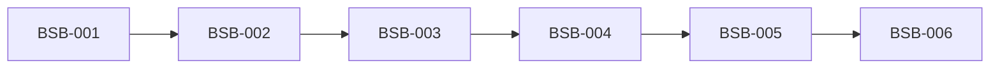

# Rorca Authenticated Browser Session Broker — Software Design

## Architecture
The canonical dependency diagram below defines the declared delivery topology.

## Components
### BSB-001 — Dedicated browser profiles keep external identity secrets outside model context
Implement BrowserSessionBroker as a Rorca AuthorityProviderAdapter for dedicated external test identities. Store encrypted domain-bound profile artifacts and SecretStore references with provider, account alias, allowlisted origins, enrollment provenance, health state, generation, retention, and destruction policy; never store cookies or TOTP seeds in authority rows. Human enrollment completes login/MFA/passkey on an operator-controlled surface. Use core ProviderBinding/receipt storage; no plaintext child table or customer identity dependency.

**Boundaries**
- No explicit component boundary was declared.

### BSB-002 — Expiring browser leases isolate one run, purpose, profile, and domain set
Implement browser.session.request, use, revoke, and reconcile under the core grant/lease state machine. Bind each lease to run, story, purpose, profile generation, allowed origins/actions, maximum concurrent runner count, expiry, evidence contract, and destruction/preservation policy. Launch a fresh isolated browser runner with constrained network/filesystem/artifact access. Revocation terminates use and clears ephemeral state; uncertain termination reconciles before reuse.

**Boundaries**
- Depends on BSB-001

### BSB-003 — Step-up authentication pauses durably for the human operator
Detect login expiry, consent, MFA, passkey, CAPTCHA, account lock, and provider step-up states as structured authentication requests. Transition the run to WAITING_FOR_AUTHENTICATION with the exact provider/profile/purpose/evidence and a separate expiry; stop story timeout. Present an operator takeover surface that never exposes model control during the human step. Resume once after health revalidation. Enforce documented provider terms and anti-automation constraints; never bypass, auto-solve, or extract secrets.

**Boundaries**
- Depends on BSB-002

### BSB-004 — Claude onboarding proves a real MCP consumer journey on a Rorca-owned fixture
Create a disposable Rorca-owned MCP conformance fixture with deterministic OAuth consent, one harmless tool, refresh, and revocation endpoints; it is test infrastructure, not Categoric. Through a dedicated Claude consumer test identity and leased browser runner, perform real install/connect, consent, tool invocation, refresh, revoke, and post-revocation failure. Capture redacted screenshots, accessibility snapshots, network metadata, MCP result hashes, provider/session state, and revocation proof in one ExecutionReceipt.

**Boundaries**
- Depends on BSB-003

### BSB-005 — ChatGPT onboarding produces evidence equivalent to the Claude journey
Run the same Rorca-owned MCP conformance fixture journey through a separately enrolled ChatGPT consumer test identity and profile. Preserve provider-specific UI differences while requiring equivalent install/connect, consent, tool, refresh, revoke, and post-revocation observations and the same redaction/provenance classes. Do not reuse the Claude profile, lease, cookies, account, or OAuth grant.

**Boundaries**
- Depends on BSB-004

### BSB-006 — Browser-session attacks and crashes leave accounts healthy and evidence complete
Inject crashes at enrollment handoff, lease issue, navigation, consent, tool call, refresh, revoke, and receipt settlement. Attempt prompt extraction of cookies/TOTP/tokens, cross-domain/profile/provider use, expired/replayed lease, revoked-session reuse, automation during takeover, evidence tampering, and network escape. Qualify only dedicated test identities. Rollout remains experimental and off by default; rollback revokes leases, kills runners, quarantines profiles, disables the broker, and retains redacted receipts. Non-goals are personal accounts, general browsing, CAPTCHA solving, credential export, provider-policy circumvention, and unattended production browser automation.

**Boundaries**
- Depends on BSB-005

## Data changes
- No data changes were declared.

## API changes
- No API changes were declared.

## Security and privacy
- No additional security or privacy constraints were declared.

## Migrations
- No migrations were declared.

## Operational concerns
- No additional operational concerns were declared.
