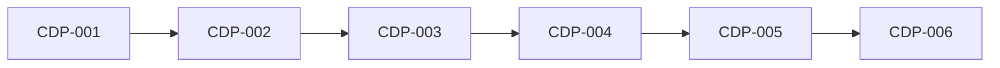

# Rorca Coolify Staging and Protected Production Adapter — Software Design

## Architecture
The canonical dependency diagram below defines the declared delivery topology.

## Components
### CDP-001 — Coolify bindings identify one application and environment without leaking control credentials
Implement a generic Coolify AuthorityProviderAdapter and ProviderBinding using immutable project/application/environment UUIDs, base URL, verified profile, capability policy, binding generation, and a SecretStore reference to the control token. Preflight checks API reachability, exact target identity, allowed actions, token scope, and environment isolation. Use core tables/routes and no provider-specific secret column or child migration. Staging and production bindings are distinct; name-only matching and cross-environment fallback are prohibited.

**Boundaries**
- No explicit component boundary was declared.

### CDP-002 — Bounded staging leases deploy an exact revision and report health
Implement deploy.staging for an immutable commit/image digest plus configuration-binding generation. A pre-authorized staging policy may issue a bounded single-run lease without interactive approval after core preflight. Trigger the deployment through the adapter, observe provider status and declared health signals, settle an ExecutionReceipt, and reconcile unknown outcomes by deployment id. No production target or credential is reachable through this capability.

**Boundaries**
- Depends on CDP-001

### CDP-003 — Immutable release intent invalidates approval when any production input changes
Define a versioned ReleaseIntent in the core OperationIntent record containing source revision, artifact/image digests, migration-set digest, configuration-binding generation, feature-flag digest, rollout cohort, change window, provider-approval reference, rollback owner/procedure, health signals, and abort conditions. Provide create/read/validate projections through the core authority API. Any material field or evidence change produces a new digest; persisted intents and receipts are immutable.

**Boundaries**
- Depends on CDP-002

### CDP-004 — Production waits for an external gate and an open change window
Implement deploy.production policy for Rorca local-single-operator posture. The local operator may request/approve under local policy, but a policy requiring independent approval must bind evidence from a reviewed external provider gate such as a GitHub protected environment; Rorca must not invent a second local identity or allow the run to self-review. Keep the run in WAITING_FOR_AUTHORIZATION or WAITING_FOR_CHANGE_WINDOW until the exact ReleaseIntent digest, provider approval, CI evidence, and window are valid. Production credentials remain unavailable before the gate.

**Boundaries**
- Depends on CDP-003

### CDP-005 — Canary health failures automatically restore the prior production revision
Deploy only the approved cohort, evaluate declared signals deterministically against abort conditions, then expand or invoke the exact rollback procedure. Capture the prior revision and binding generation before mutation. Rollback restores them under a fenced rollback lease, verifies health, and settles deploy/canary/evaluation/rollback/revocation receipts. Unknown provider outcomes are reconciled before another action.

**Boundaries**
- Depends on CDP-004

### CDP-006 — Disposable deployment attacks leave the previous service healthy
Qualify staging and protected-production behavior on disposable Rorca-owned Coolify applications. Inject digest and migration changes after approval, closed windows, denied/expired/replayed grants, cross-environment binding use, control-token extraction prompts, health aborts, and crashes at deploy/canary/rollback/revocation boundaries. Production rollout remains off until staging evidence and an external gate fixture pass. Rollback disables production capability, restores the prior revision, revokes leases, and preserves receipts. Non-goals are customer deploys, Coolify administration, secret inventory, DNS, and generalized CI/CD.

**Boundaries**
- Depends on CDP-005

## Data changes
- No data changes were declared.

## API changes
- No API changes were declared.

## Security and privacy
- No additional security or privacy constraints were declared.

## Migrations
- No migrations were declared.

## Operational concerns
- No additional operational concerns were declared.
