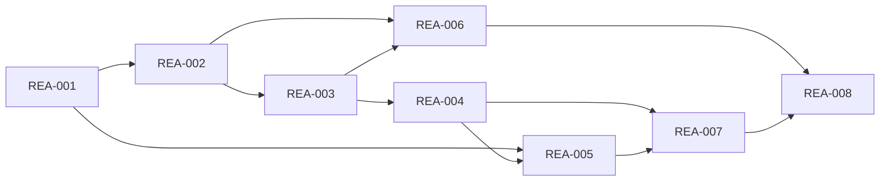

# Rorca Execution Authority Core — Software Design

## Architecture
The canonical dependency diagram below defines the declared delivery topology.

## Components
### REA-001 — Authority records survive crashes and enforce one use
Define versioned Rorca authority persistence in the next canonical backend/src/db/pg-migrations migration and matching backend contracts. Persist OperationIntent, AuthorityRequest, AuthorityDecision, AuthorityGrant, CredentialLease, ExecutionAttempt, ExecutionReceipt, and ProviderBinding with workspace/run/story principals, canonical digests, state transitions, expiry, maximumUses, idempotency keys, fencing generations, timestamps, provenance, and reference-only secret fields. Receipts are append-only. Use Rorca PostgreSQL helpers and numbered parameters; do not touch pgboss.*. Rollback policy is forward-fix plus backup/restore for populated upgrades, not ad hoc down SQL.

**Boundaries**
- No explicit component boundary was declared.

### REA-002 — Operators decide exact requests without receiving credentials
Add the Rorca authority policy service and one operator-only route resource in backend/src/routes with Swagger annotations. Create/read/cancel requests; approve or deny an exact request digest; inspect redacted receipts. The requesting execution principal and the local operator principal are distinct even though Rorca remains local single-user with authRequired=false. The requesting model cannot invoke decision mutations; provider credentials are not fields in request or decision DTOs. A grant binds workspace, run, work item, environment, resource, operation, constraints, evidence digest, expiry, and maximumUses. Mutations are admin-tier and never MCP-exposed.

**Boundaries**
- Depends on REA-001

### REA-003 — Runs settle missing authority before story execution begins
Extend canonical story/run-plan contracts with versioned required-capability declarations containing capability id, binding reference, environment/resource scope, requested mode, and evidence requirements. At enqueue, compile the union for all runnable stories, ask registered adapters to validate binding health and credential mintability, and batch missing requirements before dispatch. Persist WAITING_FOR_AUTHORIZATION, WAITING_FOR_AUTHENTICATION, and WAITING_FOR_CHANGE_WINDOW as run states. Waiting uses a separate request expiry and never consumes story execution timeout. Recompile when spec revision, binding generation, or policy changes.

**Boundaries**
- Depends on REA-002

### REA-004 — Privileged effects resume without duplication after interruption
Add the trusted operation executor around existing completion-runner durability patterns. Every provider effect moves through reserved, running, uncertain, and settled attempt states under an idempotency key and fencing generation. Crash recovery reconciles an uncertain external result through the adapter read path before retrying. The executor preserves completed work, resumes an authorized operation effectively once, and settles a redacted ExecutionReceipt before releasing the run. No narrative blocked note substitutes for the state machine.

**Boundaries**
- Depends on REA-003

### REA-005 — Provider adapters resolve secret references without ambient credentials
Define provider-neutral AuthorityProviderAdapter and RuntimeSecretBindingAdapter contracts for capability description, health preflight, lease preparation, execute, reconcile, revoke, and redacted receipt projection. Define SecretStore for reference resolution and attributable access audit. Keep the existing encrypted database vault as the default zero-network/offline adapter. Add an optional Infisical adapter behind configuration; it is never the default and must fail closed on unavailable, stale, or unauthorized resolution. Job payloads and model prompts carry opaque references only; values materialize inside the trusted broker boundary for the minimum operation lifetime.

**Boundaries**
- Depends on REA-001
- Depends on REA-004

### REA-006 — Operators can inspect and control durable authority waits
Add an Execution Authority operator surface using src/lib/apiFetch and existing panel/SlideOver patterns. Show a keyboard-accessible approval inbox, exact request digest and scope, evidence and binding health, expiry/max uses, run/story location, and approve/deny/cancel controls. Run views display each typed waiting state and distinguish wait expiry from story execution timeout. Render loading, empty, stale, denied, error, and resumed states. No secret value may enter React state, DOM text, localStorage, screenshots, or analytics.

**Boundaries**
- Depends on REA-002
- Depends on REA-003

### REA-007 — Redaction and scope violations fail closed at every boundary
Centralize authority redaction for request payloads, execution job data, logs, errors, WAL events, SSE, API projections, and receipts. Add secret canaries and adversarial cases for prompt-driven reveal attempts, operator-digest forgery, request mutation, expiry, replay, maximum-use exhaustion, cross-run/workspace/environment/resource reuse, revoked leases, and broker egress outside the adapter allowlist. Preserve existing autonomous bwrap isolation and cleared model environments.

**Boundaries**
- Depends on REA-004
- Depends on REA-005

### REA-008 — Authority rolls out without changing legacy delivery defaults
Ship the authority core behind an off-by-default workspace capability profile. Existing specs without required-capability declarations retain current local execution and provider-neutral LocalReviewBundleAdapter behavior. Initially register no mutation-capable provider adapter. This seven-spec program remains pending and cannot approve or run itself. Until the GitHub authority adapter is accepted, program execution policy is branch-only: preserve isolated run branches and reject protected-branch push, PR merge, release, and production effects. Document schemas, API contracts, recovery, retention, operator ceremony, rollout, and forward-fix procedures only after a disposable Rorca-owned smoke fixture passes. Non-goals are hosted auth, tenants, SSO, billing, enterprise RBAC, generalized marketplace discovery, and speculative providers.

**Boundaries**
- Depends on REA-006
- Depends on REA-007

## Data changes
- No data changes were declared.

## API changes
- No API changes were declared.

## Security and privacy
- No additional security or privacy constraints were declared.

## Migrations
- No migrations were declared.

## Operational concerns
- No additional operational concerns were declared.
