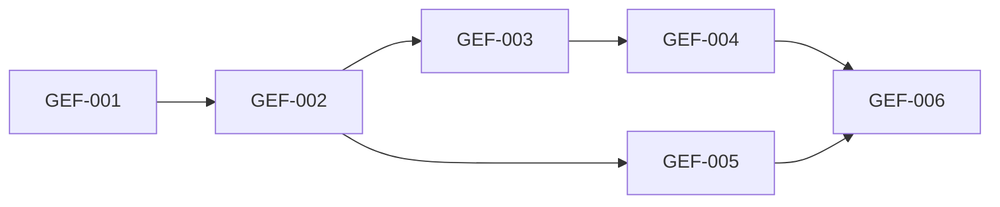

# Rorca GitHub Execution Foundation — Software Design

## Architecture
The canonical dependency diagram below defines the declared delivery topology.

## Components
### GEF-001 — GitHub authority reuses the accepted provider-neutral delivery boundary
Reconcile the new optional GitHub adapter with Rorca existing GitHub App binding, installation-token provider, workspace GitHub routes/UI, and accepted LocalReviewBundleAdapter architecture. Extend those surfaces rather than duplicating registration, credentials, migrations, routes, or settings UI. Implement the core AuthorityProviderAdapter contract for a generic workspace-bound repository. LocalReviewBundleAdapter remains the default and requires no GitHub account; GitHub is an opt-in external-send adapter. Use the core ProviderBinding tables and routes, so no GitHub-specific secret column or separate authority table is introduced.

**Boundaries**
- No explicit component boundary was declared.

### GEF-002 — Repository-scoped installation leases expose only reviewed SCM capabilities
Map scm.repository.read, scm.branch.write, scm.pull_request.write, scm.checks.read, and scm.review.request to a GitHub App installation binding. Mint short-lived installation access tokens for exactly one approved repository and permission profile; cache only in memory for the lease; inject only into the trusted adapter process; revoke or allow bounded expiry after settlement. Preflight validates installation state, repository ownership/name/id, verified provider profile, app permission grant, token mintability, and binding generation. Exclude PAT, developer SSH, repository secret, and signing-key fallbacks.

**Boundaries**
- Depends on GEF-001

### GEF-003 — Authorized SCM delivery produces a review branch but never merges
Implement typed adapter operations for prepareRepository at the approved revision, createBranch using a collision-safe run/story identity, commit with the Rorca machine identity, push the feature branch under a separate external-send grant, create or update one pull request, observe checks, and request review. Use isolated worktrees and existing DeliveryAdapter semantics. Reject protected-branch push, force push, merge, tag, release, repository settings, Actions-secret mutation, and production deployment. A restarted operation discovers existing branch/PR resources before creating anything.

**Boundaries**
- Depends on GEF-002

### GEF-004 — SCM receipts reconcile unknown outcomes and revoke every lease
Implement GitHub-specific reconcile and revoke behavior over the core attempt state machine. Mark externally accepted operations with stable repository, branch, commit, pull-request, check-run, and installation resource identifiers. On crash, query those identifiers before retry. Remove the isolated worktree after settlement while preserving the branch/review artifact according to policy. Revocation failure remains reconciliation-required and blocks new use.

**Boundaries**
- Depends on GEF-003

### GEF-005 — Operators can qualify repository bindings without handling tokens
Extend the existing GitHub settings surface and API rather than creating a second panel. Display app registration readiness, installation/repository binding, verified profile, granted permissions, token-mint probe result, binding generation, and capability availability. Allow explicit bind, revalidate, and disable operations under existing local provider-mutation authority. Never display or accept installation tokens. Data changes remain in core ProviderBinding and audit records; no child migration.

**Boundaries**
- Depends on GEF-002

### GEF-006 — Disposable-repository attacks cannot broaden SCM authority
Qualify the adapter on a disposable Rorca-owned repository with protected main and no customer workspace dependency. Inject prompt requests to reveal credentials, push main, merge, access another repository, read secrets, alter approved arguments, reuse a revoked token, replay a grant, and crash at each external boundary. Keep the adapter disabled by default after qualification; rollout is per healthy binding. Rollback disables the adapter, revokes leases, preserves local review bundles, and retains receipts.

**Boundaries**
- Depends on GEF-004
- Depends on GEF-005

## Data changes
- No data changes were declared.

## API changes
- No API changes were declared.

## Security and privacy
- No additional security or privacy constraints were declared.

## Migrations
- No migrations were declared.

## Operational concerns
- No additional operational concerns were declared.
