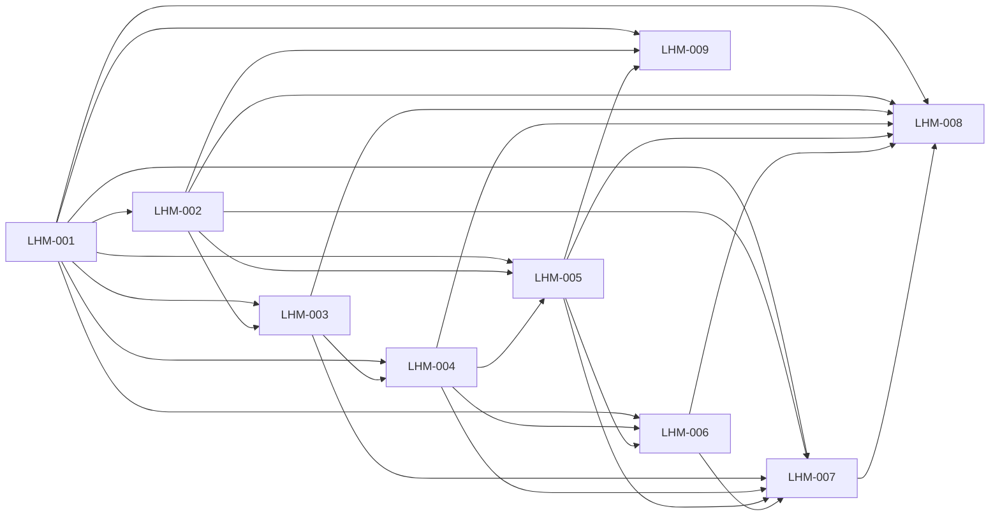

# Rorca Launch Handoff: DB Modes, Graph Lite, and Hermes — Software Design

## Architecture
The canonical dependency diagram below defines the declared delivery topology.

## Components
### LHM-001 — Add a canonical database capability model and redacted runtime status surface
Introduce a single source of truth for database mode, provider, extension support, warnings, and graph capability so the rest of Rorca can reason about native local Postgres, Docker Postgres with AGE, and BYOP hosted Postgres consistently while also finishing any remaining gaps in Miguel’s setup/bootstrap work with the minimum necessary changes.

**Boundaries**
- No explicit component boundary was declared.

### LHM-002 — Implement BYOP database handling for Supabase and other hosted Postgres providers
Allow users to provide, validate, and persist their own PostgreSQL connection string and switch into byop mode for Supabase, Neon, and similar providers without relying on local Docker or native bootstrap logic.

**Boundaries**
- Depends on LHM-001

### LHM-003 — Add Graph Lite providers and graceful fallback behavior
Create a graph abstraction that uses Apache AGE for full mode and relational or semantic fallback logic for Graph Lite when AGE is unavailable, so hosted BYOP providers still have useful graph-related features.

**Boundaries**
- Depends on LHM-001
- Depends on LHM-002

### LHM-004 — Update Knowledge Graph and health UI to be honest in full and lite modes
Expose database mode and graph capability in the UI so users understand whether they are in full graph, Graph Lite, or disabled mode, and keep dependency, relevance, and memory views useful in degraded states.

**Boundaries**
- Depends on LHM-001
- Depends on LHM-003

### LHM-005 — Add explicit DB mode selection UX for onboarding and settings
Provide a clear user-facing path to choose native managed Postgres, Docker Postgres with AGE, or BYOP hosted Postgres during first install/setup and later in settings, while reflecting the completed native/Docker setup path rather than a half-finished bootstrap flow.

**Boundaries**
- Depends on LHM-001
- Depends on LHM-002
- Depends on LHM-004

### LHM-006 — Package Hermes skills and verify MCP discovery against the real Rorca tool surface
Make Rorca usable from Hermes by packaging the skills, documenting the install/update path, and verifying that Hermes can register and discover the current Rorca MCP surface without overclaiming unsupported features.

**Boundaries**
- Depends on LHM-001
- Depends on LHM-004
- Depends on LHM-005

### LHM-007 — Truth-align launch docs, install paths, and deployment guidance
Update the user-facing docs and launch scripts so README, Quickstart, Supabase, MCP, install, and Helm guidance match the real implementation and either validate or remove broken claims.

**Boundaries**
- Depends on LHM-001
- Depends on LHM-002
- Depends on LHM-003
- Depends on LHM-004
- Depends on LHM-005
- Depends on LHM-006

### LHM-008 — Lock the capability layer with regression tests and Miguel boundary checks
Add focused backend, frontend, and extension coverage proving that mode detection, Graph Lite fallback, UI honesty, Hermes discovery, and BYOP handling work correctly while finishing and protecting Miguel’s full-graph setup path end-to-end.

**Boundaries**
- Depends on LHM-001
- Depends on LHM-002
- Depends on LHM-003
- Depends on LHM-004
- Depends on LHM-005
- Depends on LHM-006
- Depends on LHM-007

### LHM-009 — Require pgvector for every PostgreSQL install path
Validate that native/local Postgres, Docker Postgres with AGE, and BYOP hosted Postgres such as Supabase or Neon all have pgvector available before the setup is accepted, and surface a clear fix path when it is missing.

**Boundaries**
- Depends on LHM-001
- Depends on LHM-002
- Depends on LHM-005

## Data changes
- No data changes were declared.

## API changes
- No API changes were declared.

## Security and privacy
- No additional security or privacy constraints were declared.

## Migrations
- No migrations were declared.

## Operational concerns
- No additional operational concerns were declared.
