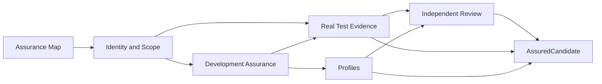

# Rorca Spec-Aligned Feature Assurance SSDLC — Software Design

## Architecture
The canonical dependency diagram below defines the declared delivery topology.

## Components
### AFM-001 — Project a revision-bound Feature Assurance Map
Add a read-only Feature Assurance Map that projects the current lifecycle plan, requirements, acceptance criteria, implementation stories, controls, evidence records, decisions, and work-package facts into one traceable view. It reports verified, pending, stale, blocked, and unavailable relationships without changing lifecycle state.

**Boundaries**
- No explicit component boundary was declared.

### AFM-002 — Bind assurance candidates to exact subject and scope
Create canonical identity and scope checks for an assurance candidate. A candidate binds the selected specification revision and lifecycle plan to the implementation commit, source tree, diff, allowed paths, changed paths, test executions, and produced artifacts when present. Broken lineage is an explicit finding, not a recoverable success.

**Boundaries**
- Depends on AFM-001

### AFM-003 — Compile Development Assurance obligations from changed work
Implement Development Assurance as a deterministic compiler that converts the bound feature, requirements, risks, architecture decisions, and implementation scope into explicit obligations and checks. It reuses current work-package and lifecycle seams rather than creating a parallel governance engine.

**Boundaries**
- Depends on AFM-002

### AFM-004 — Normalize real test execution and requirement coverage
Add a canonical test-obligation, test-case, execution, result, and coverage model fed by real runner output. Start with JUnit XML plus Jest or Vitest and Pytest result adapters; retain exact execution provenance and evaluate coverage through stable obligation identifiers, not test-name substring guesses.

**Boundaries**
- Depends on AFM-002
- Depends on AFM-003

### AFM-005 — Compile proportionate assurance profiles with workspace extensions
Provide deterministic, versioned assurance profiles that refine common controls for a workspace without modifying Rorca core contracts. Profile selection is based on the bound product, requirements, risks, architecture, and change scope; extensions remain namespaced, inspectable, and unable to erase required baseline controls.

**Boundaries**
- Depends on AFM-002
- Depends on AFM-003

### AFM-006 — Evaluate isolated review axes and adversarial assurance cases
Add independent Standards, Design, and adversarial review axes for feature assurance work. Each reviewer receives a bounded subject and returns structured findings with exact source locations, severity, disposition, freshness, and reviewer provenance. Results are evidence for inspection, never self-issued approval.

**Boundaries**
- Depends on AFM-001
- Depends on AFM-003
- Depends on AFM-004
- Depends on AFM-005

### AFM-007 — Dogfood a non-authorizing AssuredCandidate handoff
Dogfood the complete feature-assurance path in Rorca and emit an AssuredCandidate only when the selected candidate has all required bound evidence or explicit unresolved findings. The handoff is a read-only, revision-bound data product for later consumers; it cannot change lifecycle status, merge code, perform production actions, or bypass existing governance.

**Boundaries**
- Depends on AFM-001
- Depends on AFM-002
- Depends on AFM-003
- Depends on AFM-004
- Depends on AFM-005
- Depends on AFM-006

## Data changes
- No data changes were declared.

## API changes
- No API changes were declared.

## Security and privacy
- No additional security or privacy constraints were declared.

## Migrations
- No migrations were declared.

## Operational concerns
- No additional operational concerns were declared.
