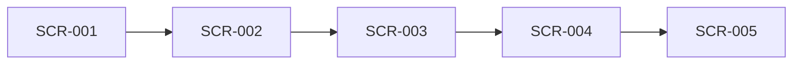

# Rorca Stripe Credential Authority Adapter — Software Design

## Architecture
The canonical dependency diagram below defines the declared delivery topology.

## Components
### SCR-001 — Stripe bindings inventory least-privilege credentials without storing values
Implement a generic Stripe AuthorityProviderAdapter and ProviderBinding inventory for account, test/live mode, application/resource binding, key kind, permission manifest, owner, fingerprint, SecretStore reference, target-binding reference, status, binding generation, and last verification. Treat webhook signing secrets as a distinct credential class. Use core tables/routes and no provider-specific secret column or child migration. Never map application runtime to an unrestricted account secret when a restricted key can satisfy the declared operations.

**Boundaries**
- No explicit component boundary was declared.

### SCR-002 — Human-assisted restricted-key creation bypasses neither reauthentication nor secret isolation
Define an immutable rotation intent with current fingerprint, exact restricted permission manifest, test/live mode, target binding, canary, grace period, rollback, and human-step requirements. When Stripe Dashboard reauthentication or manual creation is required, pause in WAITING_FOR_AUTHENTICATION and present a secure operator ceremony. Capture the replacement directly into SecretStore/target binding; the model and ordinary API never receive it. Do not automate MFA, bypass provider controls, or use an unrestricted account secret as replacement.

**Boundaries**
- Depends on SCR-001

### SCR-003 — Verified canary and grace cut over before old-key revocation
Stage the replacement through RuntimeSecretBindingAdapter, run a real bounded Stripe test-mode operation matching the permission manifest, verify target health and fingerprint, then enter the declared grace period. After post-cutover verification, revoke the old key through the supported provider/human ceremony and verify old-key failure. Reconcile provider and target state before retrying uncertain steps.

**Boundaries**
- Depends on SCR-002

### SCR-004 — Rotation failure restores payment access and surfaces emergency authority
Implement failure and runtime-detection paths. Canary/cutover failure restores the prior target binding, keeps the old key active when safe, quarantines the replacement, and emits a rollback receipt. Revoked/failing runtime credentials create a structured emergency rotation request with evidence; they do not inject a new secret or bypass approval. Unknown revocation outcome is reconciled before another action.

**Boundaries**
- Depends on SCR-003

### SCR-005 — Stripe test-mode attacks cannot expose keys or interrupt the prior binding
Qualify on a dedicated Rorca-owned Stripe test account and disposable target binding. Exercise least-privilege inventory, human-assisted capture, real canary, grace, revocation verification where supported, rollback, runtime failure, replay, cross-mode/workspace denial, prompt extraction, and crash recovery. Live-mode remains disabled until separately authorized evidence exists. Rollback disables the adapter, restores the prior target binding, revokes/quarantines replacements, and preserves receipts. Non-goals are payment-product changes, billing logic, webhook processing, customer accounts, and automatic provider-control bypass.

**Boundaries**
- Depends on SCR-004

## Data changes
- No data changes were declared.

## API changes
- No API changes were declared.

## Security and privacy
- No additional security or privacy constraints were declared.

## Migrations
- No migrations were declared.

## Operational concerns
- No additional operational concerns were declared.
