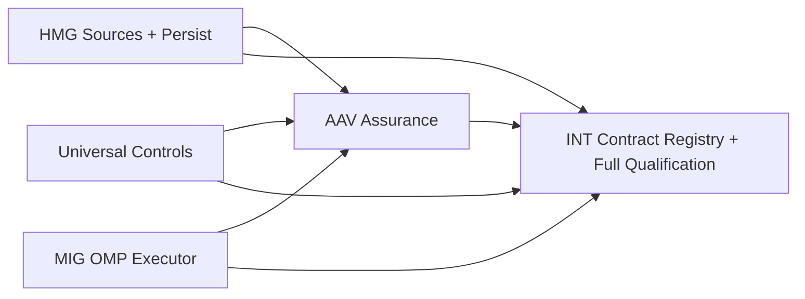

# Source-Verified Hermes–Rorca–OMP SSDLC Delivery Program — Software Design

## Architecture
The canonical dependency diagram below defines the declared delivery topology.

## Components
### US-001 — Control Catalog Schema and Validation
Implement the canonical ControlRecord contract as the sole source of truth for SSDLC controls. Create backend/src/ssdlc/schema/control-schema.ts exporting PHASES, MISSION_STAGE_BY_PHASE, SOURCE_STRENGTHS, FAILURE_SEVERITIES, EVIDENCE_DEPTHS, ControlRecord, EvidenceRequirement, parseControl(unknown), and validateControl(unknown): ValidationError[]. Emit backend/src/ssdlc/schema/control-schema.json as a JSON Schema draft 2020-12 artifact. ControlRecord has schemaVersion 'rorca.ssdlc-control-record.v1', strict semver version, controlId, phase, objective, applicability, source references, structured requiredEvidence, failure severity, exception policy, and skillRefs. Each EvidenceRequirement specifies classification, allowedSourceTypes, required subject/release bindings, minimum trust level, evidence depth, and freshness. This schema and controls.json are canonical: AAV consumes controlId and this artifact; it must not define a second catalog or controlRef shape. Follow docs/contracts/ssdlc-interoperability.md.

**Boundaries**
- No explicit component boundary was declared.

### US-002 — Genesis Source Authority Projection
Implement the Genesis source authority projection at backend/src/ssdlc/genesis/source-authority.ts. Genesis is the sole authority for evidence review status and access. Define a validated local EvidenceRecord projection { genesisEvidenceId, sourceTitle, exactCitation, evidenceStrength, supersedes?: string[], supersededBy?: string, contradictionGroup?: string } sourced from the existing Genesis bridge; it must never independently approve, trust, or promote evidence. Export getEvidence, resolveAuthority, detectContradictions, validateControlAgainstGenesis, and test-fixture registration only. Integrate with US-001 so every source reference resolves to a Genesis evidence id; raw-prose-only references are rejected. Contradictions and supersession remain explicit and carry Genesis provenance. HMG-003 consumes this same bridge-compatible projection.

**Boundaries**
- Depends on US-001

### US-003 — Layered Applicability Resolver L0-L5
Implement the layered applicability resolver at backend/src/ssdlc/applicability/resolver.ts. Profile shape: { productProfile: 'cli'|'library'|'web-frontend'|'api-service'|'mobile'|'data-pipeline'|'ai-ml'|'infrastructure'|null, riskProfile: string[], domainRegulatory: string[], workspaceConventions?: string[], specTaskOverrides?: Array<{ controlId, action: 'include'|'exclude', evidenceDepthOverride?, requirementId }> }. L0 controls with applicability.universal true are always active. L1 product profile selects by applicability.productProfiles. L2 risk profile selects by applicability.riskProfiles. L3 domain-regulatory overlay selects by applicability.domainRegulatory. L4 workspace conventions and L5 spec-task requirements apply as overrides on top of L0-L3. Export resolveActiveControls(profile) returning { activeControlIds, evidenceDepthByControlId, resolutionLog }. Evidence depth derivation: controls tied to safety-critical, aviation, or privacy-regulated receive independent-verification; controls tied to data-modifying, financial-side-effects, external-integration, or privileged-admin receive artifact; remaining active controls receive self-attestation; L4/L5 overrides are applied last and recorded in resolutionLog. Add jest tests in backend/src/ssdlc/applicability/resolver.test.ts.

**Boundaries**
- Depends on US-001

### US-004 — Phase Control Groups and Stage Readiness Compiler
Implement the phase compiler at backend/src/ssdlc/gates/gate-compiler.ts. FAMILY_MAP defines mandatory control families for each of the 11 canonical phases. Compile active controls from US-003 into 11 phase control groups with evidence requirements, then project them into the six Mission stages: intent=intake; plan=requirements+architecture; build=implementation; verify=validation+security; release=staging+qa+merge+production; learn=learn. The first five stages may block delivery when applicable controls are unresolved; learn is asynchronous and non-blocking. Risk, regulation, or governed exception may expose an approval inside its stage. This compiler owns mandatory-control selection; AAV-005 only binds mechanisms and criteria to its output.

**Boundaries**
- Depends on US-001
- Depends on US-003

### US-005 — Canonical Lifecycle Evidence and Exception Evaluation
Implement the mandatory gate evaluation engine at backend/src/ssdlc/evaluation/gate-evaluator.ts. evaluateGate consumes only canonical rorca.lifecycle-evidence.v1 records (or validated hermes.evidence.v1 ingress normalized into that record) against US-001 structured EvidenceRequirements and returns a GateEvaluationTrace. It aggregates phase results into the US-004 stage projection. A control with no matching current evidence, no evidence-backed not-applicable determination, and no valid exception is blocked. Evidence must bind the exact spec hash and release identity required by the control and be newer than the subject mutation. AAV kernel outcomes are internal and must be normalized by AAV-006 before reaching this evaluator.

**Boundaries**
- Depends on US-001
- Depends on US-002
- Depends on US-004

### US-006 — Skill Binding and Structured Findings
Implement skill binding at backend/src/ssdlc/skills/skill-registry.ts and findings ingestion at backend/src/ssdlc/skills/findings.ts. SkillRecord { skillId, name, version, controlIds[], implementationRef } binds only existing US-001 controlIds. StructuredFinding is the sole finding shape for AAV-012 through AAV-018: { findingId, controlId, skillId, requirementId?, storyId?, status: 'pass'|'fail'|'blocker', evidenceRefs, message }. ingestFindings validates each finding and blocks the matching US-004 stage when a blocker maps to an active control. No phase-review agent may introduce an alternate finding store or shape.

**Boundaries**
- Depends on US-001
- Depends on US-004
- Depends on US-005

### US-007 — Canonical Learn-Loop Candidate Generation
Implement the only learn-loop candidate store at backend/src/ssdlc/learn/learn-loop.ts. consumeProductionOutcome(outcome) classifies a production or healing outcome into reviewable Genesis candidates of four types: test-class-failed-to-predict-defect, exception-caused-rework, control-produced-no-signal, and model-underperformed-on-task-class. Candidate shape is { candidateId, type, controlId, phase, evidenceRef, signalCount, status: 'pending-review'|'approved'|'rejected' }. Deduplicate by (type, controlId, evidenceRefHash). AAV-022 adapts its outcomes into this function; it must not implement a second candidate shape or store. applyCandidate requires approved status and explicit authorized actor; no candidate auto-approves or silently rewrites the catalog.

**Boundaries**
- Depends on US-005
- Depends on US-006

### US-008 — Universal Kernel Catalog Artifact
Curate and ship the initial canonical catalog at backend/src/ssdlc/catalog/controls.json and the Genesis evidence projection fixture at backend/src/ssdlc/catalog/genesis-evidence.json. Include 20 to 40 US-001-valid controls across all 11 phase categories so US-004 reports no missing mandatory family. Source controls from ISO/IEC/IEEE 29148:2018, ISO/IEC/IEEE 42010:2022, ISO/IEC 25010:2023, ISO/IEC/IEEE 29119, NIST SP 800-218 SSDF, and DORA delivery research with exact citations. Every control provides structured evidence requirements and every requirement resolves either to a real AAV-019 adapter or an explicit governed human or approval route. This is the only catalog consumed by AAV.

**Boundaries**
- Depends on US-001
- Depends on US-002
- Depends on US-003
- Depends on US-004

### HMG-001 — Versioned source and intent contracts with strict validation
Add SourceRefV1, SourceBundleV1, SourceCitationV1, SourceConflictV1, ContextCompilationReceiptV1, IntentEnvelopeV1, and IntentDispositionV1 to shared/contracts/source.ts (and the rootDir-safe backend mirror backend/src/lib/source-contracts.ts) following the existing mission.ts versioning pattern (schemaVersion per contract, strict Zod, closed enums with explicit unknown). SourceRefV1 carries kind (genesis_package | genesis_evidence | local_file | url | github_issue | github_pr | linear_document | rorca_mission | inline), locator, title, contentHash sha256, sourceVersion, reviewStatus (approved | trusted | pending | unreviewed | external), sensitivity, authority (user_mandated | approved_context | supporting_evidence), and selectedSections. SourceBundleV1 records bundleId, bundleHash, userIntent, workspaceRef (EntityRefV1), includedSources, excludedSources with reasons, conflicts, assumptions, truncations, citations, compiledAt. IntentDispositionV1 is a closed union: answer | clarification_required | mission_draft | existing_mission_action | memory_candidate | denied, each with targetRef, draftHash, rationale, requiredDecision, permittedAction. Reject external/nested locators, unhashed content, overloaded statuses, and client-authored arbitrary actions.

**Boundaries**
- No explicit component boundary was declared.

### HMG-002 — Source adapter framework with registry and honest failure states
Define the SourceAdapter interface (canResolve, resolve, fetch, normalize) and a registry in backend/src/lib/source-adapters.ts. Each adapter returns typed SourceCandidate[] from resolve and a frozen VersionedSource from fetch (content + exact revision + sha256 hash + byte/section bounds). Adapters must fail closed on unresolvable locators, unsupported schemes, missing authority, or redaction-required content. The registry exposes listAdapters(), resolveFor(locator), and a bounded normalize pipeline that never executes commands and treats source content strictly as data.

**Boundaries**
- Depends on HMG-001

### HMG-003 — Genesis source adapter resolving canonical approved provenance
Implement the Genesis adapter (kind genesis_package | genesis_evidence) in backend/src/lib/source-adapters/genesis.ts. It resolves approved Genesis packages/evidence by id through the existing Genesis bridge/provenance surface, maps to the existing GenesisProvenanceSchema shape, and preserves bridge-derived reviewStatus approved/trusted/pending/unreviewed. Pending candidates are never presented as approved. Restricted material obeys the requesting principal's sensitivity authority and remains redacted. Selected sections reference exact evidence chunk ids and citations. Consume the US-002 Genesis authority projection; do not create a local approval registry or mutate Genesis review state.

**Boundaries**
- Depends on HMG-002
- Depends on US-002

### HMG-004 — Local file source adapter for workspace Markdown and text documents
Implement the local-file adapter (kind local_file) resolving paths relative to the active workspace root. It resolves the exact path (rejecting traversal), reads and normalizes Markdown/text, computes sha256, extracts heading-level sections with line ranges, and produces SourceRefV1 with selectedSections and citations to exact headings. A document used for one Mission is classified user-supplied source evidence; it is not automatically promoted to organizational knowledge. Offer capture-to-Genesis as an explicit separate action, never implicit.

**Boundaries**
- Depends on HMG-002

### HMG-005 — Context compiler with conflict detection and prompt-injection separation
Implement compileSourceBundle in backend/src/lib/source-compiler.ts. It merges user-mandated sources (user_mandated), approved organizational context (Direction Stack, approved Genesis knowledge, conventions), and supporting evidence (code, git, prior Missions) into a SourceBundleV1. It detects material conflicts across sources and against higher-authority direction, emitting SourceConflictV1 entries and requiring user resolution only when scope, safety, or acceptance is affected. It separates source content from instructions: external content is data, never executable instructions; secrets are redacted; and a bounded extraction contract prevents token blowup. It reuses buildForgeContextBundle for the Rorca-native context side.

**Boundaries**
- Depends on HMG-001
- Depends on HMG-003
- Depends on HMG-004

### HMG-006 — Intent intake router with visible disposition classification
Add POST /api/hermes/intent accepting IntentEnvelopeV1 and returning IntentDispositionV1. Classification is deterministic-first: explicit source refs and existing-mission refs drive mission_draft / existing_mission_action; read-only question phrasing yields answer; memory-candidate phrasing yields memory_candidate; ambiguous scope yields clarification_required; policy violation yields denied. Model synthesis may assist only after deterministic signals. The endpoint is idempotent by workspace-scoped idempotencyKey and uses the AAV-023 declared service-audit/operator-dispatch authority model. A mission_draft continues only through HMG-007's source bundle -> persist -> controls -> assurance compilation -> review/approval -> trigger sequence.

**Boundaries**
- Depends on HMG-001
- Depends on HMG-005
- Depends on AAV-023

### HMG-007 — Mission draft bridging from compiled source bundle through assurance-ready persist
Bridge a mission_draft disposition to canonical explicit-draft persistence: build PersistSpecDraft from the frozen SourceBundleV1, then POST to existing /api/specs/persist. Freeze the bundle hash, exact source refs, Genesis provenance, and the returned EntityRefV1/RevisionRefV1 in the persisted spec revision. Reject stale or mutated bundles before persistence. After persistence, invoke the canonical US-003/US-004 control compilation and AAV-001/AAV-005 assurance-profile compilation for that exact revision before review/approval can permit trigger. No legacy /api/specs/generate path is used.

**Boundaries**
- Depends on HMG-005
- Depends on HMG-006
- Depends on US-003
- Depends on US-004
- Depends on AAV-001
- Depends on AAV-005

### HMG-008 — Source-drift detection with revision and assurance invalidation
Re-hash each frozen source of an approved Mission and compare it to the recorded contentHash. When a source changes, mark the Mission context stale without silently swapping content; expose the exact old/new hash and source state. Bounded recompilation produces a new SourceBundleV1, a new spec revision, and a new assurance profile compilation receipt. The old profile and evidence remain bound to their historical revision but cannot satisfy gates for the new revision. Unknown and unavailable are distinct honest states.

**Boundaries**
- Depends on HMG-007
- Depends on AAV-001
- Depends on AAV-005

### HMG-009 — Mission OS Intent lens with requirement-to-source traceability
Extend the Mission Workspace Intent lens (src/panels/MissionWorkspacePanel.tsx, src/components/mission/) to show source provenance: Built from N sources with exact revisions/hashes, included vs excluded sections, citations linking requirements to source passages, conflict resolutions, and drift state. Reuse the Evidence Field vocabulary (text+icon+tone, unknown/unavailable distinct, one dominant action). The lens renders the frozen bundle from the delivery-case/spec read; it never re-fetches live source content and never fabricates source data not present in the projection. Accessible: keyboard navigable citations, screen-reader labels for hash chips, no color-only semantics.

**Boundaries**
- Depends on HMG-008

### HMG-010 — Gateway event family and canonical Hermes skill contract
Define the durable gateway contract for Hermes. Own versioned gateway.* payloads (mission_draft_ready, decision_required, gate_blocked, source_drift, run_completed, release_ready) carried through the existing WAL/SSE envelope beside AAV-007 orchestration.* payloads. ActionEnvelopeV1 remains a server-authored permitted action descriptor, not generic transport. Update the sole Hermes workflow skill contract at packages/rorca-pi-extension/skills/hermes-autonomous-supervisor to teach the exact implemented sequence: intent -> compile sources -> draft -> persist exact revision -> compile controls -> bind assurance -> approve -> trigger -> subscribe -> supervise -> learn. The skill uses canonical tool names exposed by AAV-011; Hermes observes, classifies, proposes, relays, notifies, and escalates while Rorca owns every canonical mutation.

**Boundaries**
- Depends on HMG-006
- Depends on HMG-007
- Depends on AAV-011
- Depends on AAV-023

### AAV-001 — Assurance profile schema attached to exact spec revisions
Define rorca.assurance-profile.v1 as an immutable artifact attached to an exact existing EntityRefV1 and RevisionRefV1 spec revision. It contains US-001 controlId-based controlInstances, mechanism bindings, criteria, structured evidence requirements, repositoryContextHash, risk profile, SourceBundleV1 bundle hash when HMG persisted source context, and compilationReceiptHash. A source-bundle or spec revision change invalidates the profile and requires recompilation; old evidence cannot silently satisfy the new revision. Product stories remain separate from lifecycle controls. Existing specs without profiles stay readable through an explicit empty/default profile path. Follow docs/contracts/ssdlc-interoperability.md.

**Boundaries**
- Depends on HMG-001
- Depends on US-001

### AAV-002 — Universal verification kernel: execute, judge, bind
Implement the tool-agnostic verification kernel in backend/src/lib/assurance-kernel.ts. verify(contract, actor) runs execute(mechanism) -> judge(outcome, criteria) -> bind(contract, outcome, actor, now) and returns an internal KernelVerificationOutcome with pass|fail|blocked and an actionable gap. The kernel has zero tool- or methodology-specific branches. It binds US-001 controlId, exact spec/revision/commit identity, actor, timestamp, mechanism identity, and outcome digest, but it does not invent a lifecycle evidence schema or decide a gate. AAV-006 is the only adapter that normalizes this outcome to canonical lifecycle evidence; US-005 owns gate decisions.

**Boundaries**
- Depends on AAV-001
- Depends on US-001

### AAV-003 — Canonical control catalog consumer and contract validation
Implement backend/src/lib/assurance-control-catalog.ts as a read-only consumer/query adapter over US-001 and US-008's canonical ControlRecord schema and backend/src/ssdlc/catalog/controls.json. It resolves controls by controlId, validates AAV compilation input against the published JSON Schema, and exposes no second catalog, controlRef type, catalog file, or ownership semantics. Add consumer-driven contract tests loading the actual US-001 schema and US-008 artifact.

**Boundaries**
- Depends on US-001
- Depends on US-008

### AAV-004 — Repository mechanism discovery from context
Implement backend/src/lib/mechanism-discovery.ts: detect repository-specific verification mechanisms from evidence (package.json scripts/deps, pyproject.toml, Cargo.toml, go.mod, existing CI workflows, AGENTS.md/governance files) and produce candidate mechanisms as executable + args vector (never untrusted shell strings), cwd, discoveredFrom file paths, and confidence. The user never has to name the tool; the repository does. Discovery is deterministic, read-only, and bounded.

**Boundaries**
- No explicit component boundary was declared.

### AAV-005 — Context-aware assurance mechanism binder
Implement the assurance binding path: HMG-persisted exact spec revision and source bundle, repository context, risk profile, US-003 applicability result, US-004 active phase groups/stage projection, and the canonical US-008 catalog feed a model proposal. The deterministic binder validates that selected mechanisms are allowed, criteria and structured evidence requirements are complete, and no selected control is weakened. It binds repository mechanisms and criteria to controls already selected by US-003/US-004; it must not independently select mandatory controls. Output is an idempotent rorca.assurance-profile.v1 bound to the exact revision and bundle hash.

**Boundaries**
- Depends on AAV-001
- Depends on AAV-003
- Depends on AAV-004
- Depends on US-003
- Depends on US-004
- Depends on HMG-001

### AAV-006 — Hermes assurance execution and canonical evidence emission
Implement the Hermes assurance adapter that executes compiled mechanism bindings, records exact mechanism identity, captures bounded results, evaluates criteria deterministically, converts AAV-002 outcomes into canonical rorca.lifecycle-evidence.v1 records, and requests US-005 stage reevaluation. It emits the sole lifecycle evidence shape, preserving the exact spec/revision/commit/release identity required by US-001. Blocked controls carry actionable gaps. Every Hermes phase-review agent (AAV-012 through AAV-018) emits US-006 StructuredFinding through this boundary. Authority follows the explicit AAV-023 service-audit/operator-dispatch split, never accidental admin fallback.

**Boundaries**
- Depends on AAV-002
- Depends on AAV-005
- Depends on US-005
- Depends on US-006
- Depends on AAV-023

### AAV-007 — Versioned OMP orchestration event ingestion
Implement provider-neutral orchestration event ingestion: project actual OMP JSONL RPC output from OmpManagedExecutor into durable rorca.orchestration-event.v1 payloads carried by the existing WAL/SSE transport. This story owns only orchestration.* payloads: agent_started, task_started, agent_progress, agent_completed, and agent_failed. Payloads retain parentage, monotonic sequence numbers, idempotent replay, and EntityRefV1-bound run/story/attempt/process identity. Unknown OMP events remain inspectable. Gateway-domain events remain HMG-010's gateway.* payload family; ActionEnvelopeV1 is never used as a generic event envelope.

**Boundaries**
- Depends on MIG-001

### AAV-008 — Structured Run View orchestration tree
Render the durable orchestration stream in the run surface (src/panels/RunViewPanel.tsx / RunTerminal): a parent agent tree with subagent lanes (I, II, III, IV) showing live status, role/name, parent-child relationship, elapsed time, tool/event summary, failure reason, produced evidence, and retry/continuation lineage. Roman numerals are presentation labels only - stable IDs underneath, since concurrency and retries reorder agents. The view reconstructs exactly after browser refresh (rebuilt from stored events, not a live terminal) and is accessible: keyboard navigable, no color-only semantics.

**Boundaries**
- Depends on AAV-007

### AAV-009 — Raw OMP terminal tab for debugging
Add an optional raw OMP terminal tab to the run surface using PTY passthrough of the omp session (terminal_mode pty path). The structured orchestration view remains the authoritative surface; the raw terminal is for operator fidelity and debugging. Reconnect behavior is explicit, terminal bytes are bounded and replayable where possible, PTY failure never invalidates structured evidence, and secrets are redacted before persistence.

**Boundaries**
- Depends on AAV-007

### AAV-010 — Assurance and OMP component parity qualification
Qualify the assurance/OMP component boundary: an exact persisted spec revision with an attached assurance profile executes under OMP; orchestration lanes render/reconstruct; a subagent failure becomes a canonical blocked control with an actionable gap; retry/continuation is visible; and acceptable evidence binds exact commit and spec identity before US-005 permits the applicable stage. This is component parity only. The complete HMG -> controls -> assurance -> OMP -> gates -> supervision -> learning proof belongs to the interoperability qualification spec.

**Boundaries**
- Depends on AAV-005
- Depends on AAV-006
- Depends on AAV-007
- Depends on AAV-008
- Depends on MIG-005

### AAV-011 — Hermes subscription to canonical run events
Expose the existing durable WAL/SSE run event envelope back into OMP so a supervising Hermes session observes live run, story, gate, evidence, orchestration.*, and gateway.* events without polling. Add rorca_subscribe_run_events to the MCP surface or an equivalent subscription with idempotent replay and workspace isolation. AAV-011 consumes AAV-007 orchestration payloads and HMG-010 gateway payloads; it does not create a second orchestrator or own the Hermes skill contract. HMG-010 is the sole skill owner and documents this implemented subscription surface.

**Boundaries**
- Depends on AAV-007

### AAV-012 — Hermes intake review agent
Hermes reviews the user brief before forging: outcome framing, scope boundaries, and risk class, returning structured findings that become intake-phase lifecycle evidence through the AAV-006 execution surface. Findings are visible and reviewable; the forge proceeds only when intake findings are satisfied or explicitly waived.

**Boundaries**
- Depends on AAV-006

### AAV-013 — Hermes requirements verification
Hermes verifies each story for verifiability and traceability (29148-style: testable, traceable, atomic) and emits per-story findings as requirements-phase evidence. Unverifiable stories are flagged with concrete gaps before implementation begins.

**Boundaries**
- Depends on AAV-006

### AAV-014 — Hermes architecture review and threat model
Hermes reviews architecture-relevant decisions in the spec (42010-style stakeholder concerns, decision rationale, threat model for the change surface) and emits architecture-phase evidence. The threat-model pass is mandatory for specs touching auth, secrets, network egress, or execution boundaries.

**Boundaries**
- Depends on AAV-006

### AAV-015 — Hermes security controls execution
Hermes executes security controls against the implementation: secrets scan, dependency check, and threat verification, emitting security-phase evidence from real artifact output. Security evidence follows the same execute -> judge -> bind -> decide kernel as every other control.

**Boundaries**
- Depends on AAV-006
- Depends on AAV-019

### AAV-016 — Hermes QA release-candidate review
Hermes performs an independent review of the completed release candidate (workflow checks, regression assessment, release-candidate acceptance) and emits QA-phase evidence. QA is distinct from validation: it judges the candidate, not the build correctness.

**Boundaries**
- Depends on AAV-006

### AAV-017 — Hermes merge verification
Hermes verifies exact-SHA change-set integrity before merge: the merged branch head matches the authorized head, the change set is complete, and no uncommitted drift exists; emits merge-phase evidence.

**Boundaries**
- Depends on AAV-006

### AAV-018 — Hermes production confirmation
Hermes confirms deployment: deployment_id binding, target identity, and post-deploy health check, emitting production-phase evidence. Unavailable or unknown deployment state is an honest distinct state, never a silent pass.

**Boundaries**
- Depends on AAV-006

### AAV-019 — Evidence adapters for real artifacts
Implement concrete adapters that turn real artifact output into AAV-002 mechanism outcomes: test_result parses Jest/Vitest/Pytest command, exit code, test summary, and requirement coverage; artifact digest captures build outputs; deployment receipt captures deployment evidence. AAV-006 maps those outcomes to the existing canonical lifecycle evidence source types/classifications and required subject/release identities. Adapters use executable+args vectors, bounded capture, and deterministic criteria; they never create a second evidence-kind taxonomy.

**Boundaries**
- Depends on AAV-002
- Depends on AAV-006

### AAV-020 — Hermes watchdog v2: diagnosis and governed healing
Implement the session-built watchdog v2 at the Hermes supervision boundary, not as a second Rorca execution-engine loop. It consumes canonical run/gate/evidence events, classifies known failures deterministically, uses LLM synthesis only for novel patterns, and proposes or invokes governed Rorca actions for restart, alternate model, worktree refresh, or authority re-provision. Rorca retains canonical mutations, leases, worktree authority, and durable receipts. Every diagnosis, action, and outcome is Hermes-bound, auditable, and follows AAV-023 authority; no controller restarts queued or running work in flight.

**Boundaries**
- Depends on AAV-006
- Depends on AAV-019
- Depends on HMG-010

### AAV-021 — Executor-neutral provider fallback policy and evidence
Implement a named provider fallback policy that the primary OMP executor applies within a story session on provider failures such as usage limit, connection error, or terminalized authority. Rorca supplies the allowed alternate chain and records the selected fallback in canonical story/lifecycle evidence; OMP performs session-level fallback. The explicit Pi fallback may consume the same policy but does not become its owner. Exhaustion preserves the original reason. This is not a return to engine-primary execution.

**Boundaries**
- Depends on AAV-020
- Depends on MIG-002

### AAV-022 — Learn-loop adapter: heal events to canonical Genesis candidates
Adapt Hermes heal events and run outcomes to US-007 consumeProductionOutcome. Preserve controlId, phase, exact evidence reference, and provenance, then return the canonical US-007 candidate. This story owns no candidate shape, deduplication key, candidate store, approval decision, or catalog mutation. Accumulated evidence may propose control or mechanism adjustments only through US-007's pending-review path.

**Boundaries**
- Depends on AAV-006
- Depends on AAV-019
- Depends on AAV-020
- Depends on US-007

### AAV-023 — Hermes authority model: service-to-operator split
Make the Hermes authority split explicit and enforced across AAV, HMG, and the watchdog: Hermes identity is used for audit and evidence; operator-equivalent authority is explicit for permitted dispatch and mutation; no accidental admin fallback exists. Every Hermes action carries a declared authority mode and audit identity. HMG intent, persist, supervision, and retry flows consume this contract.

**Boundaries**
- No explicit component boundary was declared.

### MIG-001 — OMP executor sandbox wiring
Wire the OmpManagedExecutor child through the ordinary-local Pi sandbox profile on Darwin (egress broker, auth copy, runtime state) so governed OMP story execution works on macOS; verify the existing linux-bwrap path on Linux. The OMP child must launch with the same fail-closed posture as the pi child: allowlisted env, model-credential egress, worktree confinement, death receipts.

**Boundaries**
- No explicit component boundary was declared.

### MIG-002 — Default executor flip to OMP with per-spec override
After MIG-001 has qualified OMP sandbox launch, make OMP the default story executor: pipeline dispatch selects agent omp unless explicitly overridden at spec or run level. Pi remains a fully supported fallback through explicit override. Add the executor selector to trigger UI and per-spec override field. Dispatch, manifests, watchdog restart, and retry preserve the original executor. Governance, lifecycle evidence, gate semantics, and Run View rendering remain owned by Universal Controls and AAV.

**Boundaries**
- Depends on MIG-001

### MIG-003 — Pi fallback lane insurance
Fix the pi fallback path root causes observed this session so it is dependable when used: the prompt_delivery_failed progress-log verification (pi_progress_log_unverified) and the transient api_key_invalid on retry attempts (sandbox auth copy). The fallback lane must be reliable enough for watchdog-restarted runs and per-spec overrides.

**Boundaries**
- No explicit component boundary was declared.

### MIG-004 — Wave-parallel execution verification under OMP
Verify executor-level wave-parallel execution with OMP: a wave of N parallel stories launches N concurrent OMP RPC sessions, each in its own per-story worktree, and merges per-story branches back to the run branch through commitGuardedMerge under wave-production-policy gates. Confirm generic per-agent wave machinery routes OMP stories alongside other agent types. This story owns process/worktree/merge parity and emits durable identity-bearing run results/events; AAV-007/008 own event projection and Run View rendering.

**Boundaries**
- Depends on MIG-001

### MIG-005 — OMP executor parity and rollback qualification
Qualify the executor migration only: sequential and wave-parallel OMP runs produce byte-compatible execution contracts with the explicit Pi fallback for run manifests, story results, WAL/release intent identity, retry lineage, cancellation, and rollback. It does not define lifecycle evidence semantics, gate decisions, or Run View behavior; AAV and Universal Controls consume the stable executor contracts. Prove the single-config rollback to explicitly selected Pi once after MIG-003 restores fallback reliability.

**Boundaries**
- Depends on MIG-002
- Depends on MIG-003
- Depends on MIG-004

### MIG-006 — Engine fallback posture and dispatch enforcement
Document and enforce the engine fallback-only posture after MIG-005 qualification: OMP is the default executor; Pi remains selectable as explicit fallback; Claude agent compatibility remains a deliberate per-story override. The migration plan is docs/mig-006-engine-fallback-posture.md; this spec and that plan are a bidirectional control pair. Enforce behavior through dispatch tests rather than documentation-text linting. Any future change that makes Pi default or expands its primary-executor role reopens this spec.

**Boundaries**
- Depends on MIG-005

### INT-001 — Contract registry and consumer-driven verification
Implement backend/src/ssdlc/interop/contract-registry.ts and an executable registry suite that loads provider artifacts and validates consumer expectations, not prose. Register: HMG SourceBundleV1/intent contracts; existing EntityRefV1 and RevisionRefV1; US-001 ControlRecord JSON Schema and US-008 controls.json; US-004 stage projection; rorca.assurance-profile.v1; canonical rorca.lifecycle-evidence.v1/hermes.evidence.v1; AAV-007 orchestration payloads; HMG-010 gateway payloads; US-006 StructuredFinding; US-007 candidate. Each entry names one provider, every consumer, version, and an executable validation fixture. This is the CDC release gate defined by docs/contracts/ssdlc-interoperability.md.

**Boundaries**
- Depends on US-008
- Depends on HMG-010
- Depends on AAV-006
- Depends on AAV-007
- Depends on AAV-011
- Depends on AAV-022
- Depends on MIG-005

### INT-002 — Full source-to-learning interoperability qualification
Execute the complete governed chain in an isolated qualification workspace after HMG, Universal Controls, AAV, and MIG implementation receipts exist: HMG source bundle -> explicit persist exact revision -> US-003 applicability -> US-004 phase groups/six-stage projection -> AAV mechanism binding/profile -> MIG OMP run -> canonical evidence -> US-005 stage evaluation -> Hermes subscription/healing -> US-007 candidate. Exercise a success path, forced subagent failure/recovery, and source-drift/revision invalidation. This is the only whole-program qualification; component specs retain their own focused tests.

**Boundaries**
- Depends on INT-001
- Depends on HMG-008
- Depends on HMG-010
- Depends on US-007
- Depends on US-008
- Depends on AAV-010
- Depends on AAV-011
- Depends on AAV-012
- Depends on AAV-013
- Depends on AAV-014
- Depends on AAV-015
- Depends on AAV-016
- Depends on AAV-017
- Depends on AAV-018
- Depends on AAV-022
- Depends on AAV-023
- Depends on MIG-005

### INT-003 — Executor and recovery compatibility matrix
Run the executor compatibility matrix after MIG and AAV component qualification: OMP sequential, OMP wave-parallel, heterogeneous wave with an explicit Claude or Pi story, explicit Pi fallback, restart/replay, provider fallback, and cancellation. Assert that only executor-specific behavior varies; EntityRef/RevisionRef identity, manifests, story results, WAL/release intent, canonical evidence binding, and event replay stay compatible with the contract registry.

**Boundaries**
- Depends on INT-001
- Depends on AAV-010
- Depends on AAV-021
- Depends on MIG-006

## Data changes
- No data changes were declared.

## API changes
- No API changes were declared.

## Security and privacy
- No additional security or privacy constraints were declared.

## Migrations
- No migrations were declared.

## Operational concerns
- No additional operational concerns were declared.
