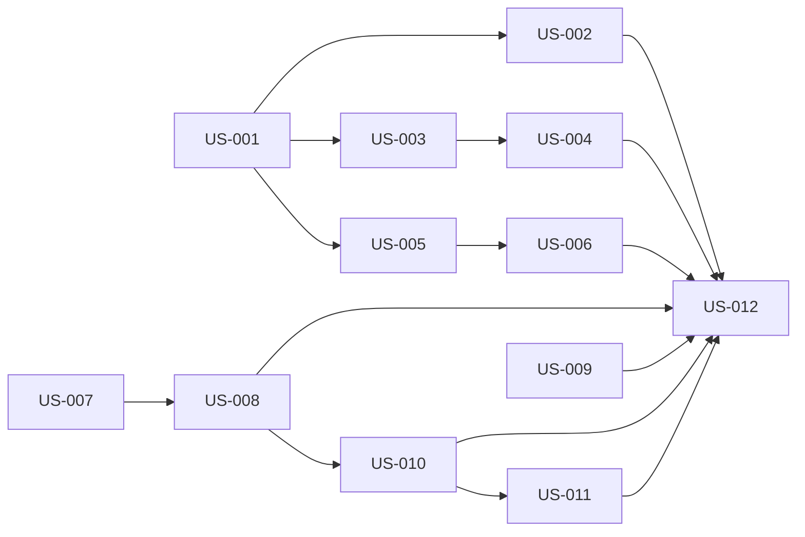

# Universal Assurance: 7-Stage SSDLC, Genesis Binding, and Phase Advisor — Software Design

## Architecture
The canonical dependency diagram below defines the declared delivery topology.

## Components
### US-001 — Seven conventional stage projection (backend contracts)
Replace the six Mission stage ids (intent/plan/build/verify/release/learn) with the seven conventional SDLC stages across the SSDLC contracts. The 11 canonical phases stay. MISSION_STAGE_BY_PHASE remaps: planning->intake, requirements->requirements, design->architecture, development->implementation, testing->validation+security+qa, deployment->staging+merge+production, maintenance->learn. maintenance stays non-blocking. Touch: backend/src/ssdlc/schema/control-schema.ts, backend/src/ssdlc/gates/gate-compiler.ts, backend/src/ssdlc/assurance-profile.ts, backend/src/ssdlc/full-interoperability-qualification.ts, lib/mission-contracts.ts + shared/contracts (bump read projection revision).

**Boundaries**
- No explicit component boundary was declared.

### US-002 — Seven-stage projection in the lifecycle matrix UI
Update src/types/lifecycle.ts LIFECYCLE_STAGES to the seven conventional stages with display labels (Planning, Requirements analysis, Design, Development, Testing, Deployment, Maintenance) and lifecycleStageOf fallback to maintenance. LifecycleMatrix already renders the stage header row data-driven; verify and update tests in src/panels/__tests__/LifecycleMatrix.test.tsx (header order, 19 columnheaders, 52 rows).

**Boundaries**
- Depends on US-001

### US-003 — LifecycleProfileV1 and plan compiler profile emission
Add backend/src/ssdlc/profiles/general-sdlc-7.ts as the single source of the stage projection: profileId, version, stages (id/label/phaseIds), blockingStages, contentHash. Make the plan compiler emit profile {profileId, profileVersion, profileHash, stages} alongside the phases in the compiled plan, and surface it in the lifecycle plan API (GET /api/lifecycle/specs/:specId).

**Boundaries**
- Depends on US-001

### US-004 — API-driven stage rendering in the matrix
LifecycleMatrix renders stage headers from the compiled plan profile when the plan response carries profile.stages, falling back to the bundled LIFECYCLE_STAGES constant when absent. No stage semantics hardcoded beyond the fallback.

**Boundaries**
- Depends on US-003

### US-005 — Skill metadata scope/appliesToStages/enforcement and baseline pack
Extend skill frontmatter parsing in backend/src/lib/skill-registry.ts with scope (universal|specialist), appliesToStages (array of the 7 stage ids), enforcement (advisory|required). Reject entrypoints with unknown stage ids instead of broadening. Include the new fields in the catalog prompt. Ship the baseline universal pack with general-sdlc-7: evidence-discipline, reversible-changes, no-placeholder-delivery, traceability. Update docs/agent-skill-packages.md.

**Boundaries**
- Depends on US-001

### US-006 — Deterministic universal skill selection with Pi/OMP parity
backend/src/lib/skill-matcher.ts: universal-scope skills are always selected within the token budget (filtered by appliesToStages); specialist skills stay LLM-reranked over the deterministic eligible set. Universal skills must reach Pi and OMP runs through the direction-stack context path (pi-autonomous-runner directionText) since the matched-skills section is skipped for pi/omp. enforcement: required reserves budget only after selection; it never creates a gate.

**Boundaries**
- Depends on US-005

### US-007 — Production Genesis authority bridge and spec_sources table
Implement the production GenesisAuthorityBridge (backend/src/lib/source-adapters/genesis.ts interface) wired to the Genesis bridge endpoint, and add a pg-migration for spec_sources (spec_id, source_kind, source_id, package_hash, content_hash, citation_summary, evidence_chunk_ids, citations jsonb, review_status, sensitivity, bound_at, bound_by) with immutable rows. Restricted chunks must stay redacted through resolveGenesisSource.

**Boundaries**
- No explicit component boundary was declared.

### US-008 — Verified Genesis binding at spec persist and binding API
Extend PersistSpecDraftSchema with optional genesisSource {kind, id, principalId, selectedChunkIds}. On persist, resolve through the bridge, store only verified provenance in spec_sources, and reject forged/redacted/unapproved provenance (no row). GET spec returns boundSources. Add POST /api/specs/:specId/genesis-sources for binding after persist (idempotent). Canon sufficiency request includes bound package ids (genesisPackageIds).

**Boundaries**
- Depends on US-007

### US-009 — Run findings feed-forward (Rorca operational authority)
On run completion derive a structured findings record (decisions made, deviations from spec, discovered risks, new conventions) alongside the existing story-result evidence derivation. Findings update workspace L2/L3 context and MEMORY.md through the existing memory synthesis path, and become explicit Genesis capture candidates via the explicit-action adapter only (no silent promotion).

**Boundaries**
- No explicit component boundary was declared.

### US-010 — Per-phase compiled coverage in the lifecycle UI
Spec readiness gains coverageByPhase (phaseId -> covered/uncovered requirement cells, missing skills, nextActions) derived from engineering canon coverage cells. The lifecycle phase drill-down renders the coverage section: what the phase requires, what is covered, what is missing, bound Genesis packages. Absent canon degrades gracefully.

**Boundaries**
- Depends on US-008

### US-011 — Phase advisor endpoint and UI panel
Add POST /api/lifecycle/specs/:specId/advice accepting {phaseId, storyId?}. Input: spec typed facts + bound Genesis sources + compiled coverage for the phase; output via chatComplete: {suggestions: [{text, cites: [requirementId|controlId|sourceId]}]}. Advisory only: never persisted as evidence, never evaluated by gates, every suggestion cited. UI: advisory 'What's missing' panel in the phase view.

**Boundaries**
- Depends on US-010

### US-012 — Docs, hardening, and CI green
Update docs/contracts/ssdlc-interoperability.md (seven-stage table, profile, Genesis binding sections), docs/agent-skill-packages.md (scope/stages metadata), AGENTS.md lifecycle references. Full backend + frontend suites, tsc both sides, gitleaks. Push to GitHub and Forgejo; Forgejo CI must be green.

**Boundaries**
- Depends on US-002
- Depends on US-004
- Depends on US-006
- Depends on US-008
- Depends on US-009
- Depends on US-010
- Depends on US-011

## Data changes
- No data changes were declared.

## API changes
- No API changes were declared.

## Security and privacy
- No additional security or privacy constraints were declared.

## Migrations
- No migrations were declared.

## Operational concerns
- No additional operational concerns were declared.
