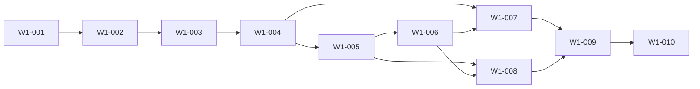

# Wave 1 — Stabilize Evidence Closeout and Provider-Neutral Local Delivery — Software Design

## Architecture
The canonical dependency diagram below defines the declared delivery topology.

## Components
### W1-001 — Freeze the stabilization baseline and protected-run deny list
Add a fail-closed Wave 1 intake guard around the existing run, closeout, reconciliation, Forge/MCP, test-database, provider-neutral delivery-adapter, and optional GitHub seams. The guard must bind work to the reviewed clean integration baseline and make externally owned Genesis run 20260316000549 structurally ineligible for every read, preview, reconciliation, retry, delivery, and mutation path introduced by this spec.

**Boundaries**
- No explicit component boundary was declared.

### W1-002 — Bind host-observed attempt evidence to exact spec and Git revisions
Complete host-observed attempt envelopes at the execution-engine and worker boundary so process identity, launch generation, worktree, immutable spec revision/hash, base and observed Git SHA, agent/runtime, timestamps, cancellation fence, and outcome provenance are durable before lifecycle interpretation.

**Boundaries**
- Depends on W1-001

### W1-003 — Separate semantic closeout and lifecycle truth from process exit
Finish run_closeout authority across backend/src/lib/run-closeout-authority.ts, execution-engine closeout, worker terminalization, and Run View projections. Process exit is one observation only; explicit durable story evidence and closeout decide semantic status.

**Boundaries**
- Depends on W1-002

### W1-004 — Fence cancellation, retries, idempotency, and isolated worktree recovery
Stabilize route, queue, worker, local-runner, engine, and story-worktree boundaries so cancellation and retry share exact immutable attempt identity, PostgreSQL-owned leases/fences, and bounded recovery. pg-boss remains transport and ordinary execution stays sequential with parallelism 1 and branch-only delivery.

**Boundaries**
- Depends on W1-003

### W1-005 — Productize exact-run closeout reconciliation preview authority
Provide a read-only reconciliation preview and separately authorized apply path across backend reconciliation routes and src/lib/run-closeout-reconciliation.ts. Bind a canonical run, spec revision, evidence snapshot, target closeout transition, expiry, and deterministic preview hash without granting ordinary execution authority.

**Boundaries**
- Depends on W1-004

### W1-006 — Compose reconciliation under advisory locks with isolated evidence events
Make reconciliation a narrowly scoped PostgreSQL transaction that composes with existing advisory locks, lifecycle writes, and pass reconciliation. It may append dedicated reconciliation evidence/events and settle eligible closeout rows only; it must not traverse ordinary execution or release side effects.

**Boundaries**
- Depends on W1-005

### W1-007 — Define archived pg-boss recovery without reviving semantic work
Reconcile pg-boss v10 live/archive transport state with canonical PostgreSQL run authority. Recovery must infer no semantic success from transport disappearance and must never resurrect a terminal or superseded generation.

**Boundaries**
- Depends on W1-004
- Depends on W1-006

### W1-008 — Make Forge and MCP artifacts reproducible across reviewed integration
Stabilize explicit-draft Forge, public-contract generation, MCP discovery, provider-neutral delivery reads, and packaged Pi extension outputs so the reviewed source tree, generated assets, and installed package expose the same canonical create/readiness/workflow/reconciliation/local-review-bundle contracts without backend drafting or untracked package drift.

**Boundaries**
- Depends on W1-005
- Depends on W1-006

### W1-009 — Enforce isolated test-database authority and independent stabilization review
Make DB-backed validation self-identifying and fail closed unless it uses a fresh PostgreSQL 16 test database owned by the dedicated non-superuser test role. Produce a bounded independent review packet covering Forge/MCP, closeout, reconciliation, transport recovery, provider-neutral local delivery, security, and side-effect exclusions.

**Boundaries**
- Depends on W1-007
- Depends on W1-008

### W1-010 — Prove provider-neutral delivery with an immutable local review bundle
After W1-001 through W1-009 local implementation gates are complete, exercise the default LocalReviewBundleAdapter only against an isolated local proof fixture. Finalize one immutable content-addressed review bundle without any GitHub, PAT, remote account, webhook, network provider, merge, deployment, or live-run authority; GitHub remains an optional uninvoked adapter.

**Boundaries**
- Depends on W1-009

## Data changes
- No data changes were declared.

## API changes
- No API changes were declared.

## Security and privacy
- No additional security or privacy constraints were declared.

## Migrations
- No migrations were declared.

## Operational concerns
- No additional operational concerns were declared.
