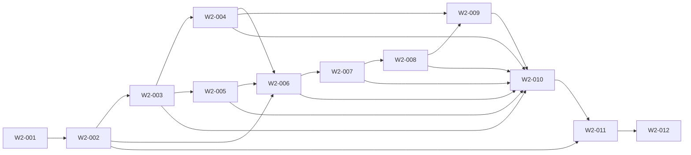

# Wave 2 — Governed Mission, Work Package, Lease, Evidence and Lifecycle Contracts — Software Design

## Architecture
The canonical dependency diagram below defines the declared delivery topology.

## Components
### W2-001 — Fail closed on the exact ROR-24 ADR and Wave 1 gates
Create a gate-only intake verifier for ROR-23. It must resolve the exact accepted ROR-24 ADR artifact and immutable authority identity, plus the independently reviewed Wave 1 completion packet, before migrations, contract publication, dispatch, or implementation work begins.

**Boundaries**
- No explicit component boundary was declared.

### W2-002 — Publish versioned MissionContract primitives and compatibility rules
Define MissionContract and shared identifiers in packages/rorca-public-contract with JSON Schema/OpenAPI projections. A MissionContract is an immutable compilation of canonical spec revision, policy versions, approved decisions, repository authority, and allowed execution posture; PostgreSQL is canonical and Git is code truth.

**Boundaries**
- Depends on W2-001

### W2-003 — Persist stable missions and revisioned mutable work packages
Add numbered PostgreSQL migrations and repositories for immutable mission contract versions and mutable, revisioned work packages under stable mission authority. Work-package changes are proposals with optimistic concurrency, not silent mission mutation.

**Boundaries**
- Depends on W2-002

### W2-004 — Issue fenced execution leases bound to runtime and repository identity
Define canonical execution-lease acquisition, renewal, expiry, release, and supersession. Leases authorize bounded execution only for one mission/work-package revision, runtime/repository identity, and exact canonical continuation references; they grant no approval, closeout, merge, or deployment authority.

**Boundaries**
- Depends on W2-003

### W2-005 — Publish canonical policy, checkpoint, retrieval, bundle, and continuation contracts
Publish the canonical context-continuation family without a second mutable context authority. Rorca owns immutable policy definitions, scope activations/revocation, checkpoints, receipts, bundle/delta verification, lease verification, retry budget, and one-use dispatch; Hermes orchestrates and memory remains advisory.

**Boundaries**
- Depends on W2-003

### W2-006 — Normalize runtime-neutral execution and context-continuation events
Define one versioned runtime-neutral envelope for attempt/activity and canonical continuation projections. Events carry immutable canonical references and exact turn/compaction/retry/completion-candidate facts while raw PTY remains separate observability.

**Boundaries**
- Depends on W2-002
- Depends on W2-004
- Depends on W2-005

### W2-007 — Persist host-observed evidence envelopes with explicit trust
Define evidence envelopes that distinguish host-observed facts, runtime assertions, provider-verified facts, automated test results, and human decisions. Evidence is append-only and exact-subject-bound; only policy-authorized evidence kinds may contribute to closeout.

**Boundaries**
- Depends on W2-006

### W2-008 — Resolve closeout and lifecycle decisions from canonical evidence
Compile eligible exact-subject evidence into a proposed attempt/work-package closeout, then apply existing SSDLC lifecycle policies and provider-human decisions without transferring their authority to runtimes. Process exit and transport completion remain observations only.

**Boundaries**
- Depends on W2-007

### W2-009 — Govern cancellation acknowledgements and plan-change proposals
Add contracts for durable cancellation request/acknowledgement and runtime plan-change proposals. A runtime may acknowledge cancellation or propose bounded changes but cannot mutate canonical scope, dependencies, revisions, approvals, or lifecycle state.

**Boundaries**
- Depends on W2-004
- Depends on W2-008

### W2-010 — Expose authorized idempotent service APIs and audit trails
Add route/service/repository APIs for mission compilation/read, work-package revisions, leases, policy definitions/activations, checkpoints/receipts/bundles/deltas/dispatch/retry budgets, events/evidence, cancellation, proposals, and closeout. Every route validates tenant/workspace/runtime/human authority and emits bounded immutable audit records.

**Boundaries**
- Depends on W2-003
- Depends on W2-004
- Depends on W2-005
- Depends on W2-006
- Depends on W2-007
- Depends on W2-008
- Depends on W2-009

### W2-011 — Preserve current executor behavior behind compatibility projections
Introduce adapters that project current pipeline-run/story/attempt data into the new contracts without changing execution-engine semantics. Generate MCP as an optional projection of canonical HTTP/service contracts; it is not the federation protocol or authority source.

**Boundaries**
- Depends on W2-002
- Depends on W2-010

### W2-012 — Pass threat-model, conformance, recovery, and independent review gates
Deliver a reusable DB-backed contract conformance suite, security threat model, operational/recovery runbook, migration compatibility matrix, and independent review packet before Wave 2 can gate Wave 3 work.

**Boundaries**
- Depends on W2-011

## Data changes
- No data changes were declared.

## API changes
- No API changes were declared.

## Security and privacy
- No additional security or privacy constraints were declared.

## Migrations
- No migrations were declared.

## Operational concerns
- No additional operational concerns were declared.
