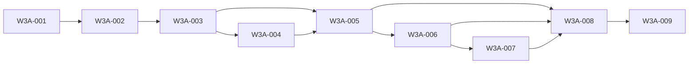

# Wave 3A — Wrap Current Engine as RorcaManagedExecutor — Software Design

## Architecture
The canonical dependency diagram below defines the declared delivery topology.

## Components
### W3A-001 — Gate RorcaManagedExecutor work on exact Wave 2 contracts
Start ROR-28 only from the independently reviewed Wave 2 contract/version/SHA packet. Reserve a separate worktree and ownership zone; ROR-25 is the only permitted concurrent wave and no shared-file overlap may be silently accepted.

**Boundaries**
- No explicit component boundary was declared.

### W3A-002 — Define ExecutionAdapter and RorcaManagedExecutor boundaries
Add a runtime-neutral ExecutionAdapter interface around the canonical service contracts and implement the first adapter named RorcaManagedExecutor. Keep TaskManifest broker, queue transport, lifecycle resolver, release authority, and provider-human decisions outside the adapter.

**Boundaries**
- Depends on W3A-001

### W3A-003 — Translate governed work inputs into canonical engine inputs
Build a deterministic translation from MissionContract, work-package revision, fenced lease, active policy activation, and verified canonical context bundle to existing engine prompt/model/terminal/story/worktree/timeout/retry/branch-only inputs.

**Boundaries**
- Depends on W3A-002

### W3A-004 — Preserve four-engine symmetry and environment isolation
Route Claude, OpenCode, Codex, and Pi through the adapter while retaining the current engine's symmetric tool/output contract, provider-specific invocation, secret stripping, process sandboxing, timeout, output bounds, and cancellation behavior.

**Boundaries**
- Depends on W3A-003

### W3A-005 — Fence launch, worktree mutation, and duplicate execution
Compose PostgreSQL execution leases with existing launch gates and story-worktree lifecycle. Every process generation must hold the exact active fence before mutation and lose mutation/result eligibility on cancellation, expiry, supersession, or revision drift.

**Boundaries**
- Depends on W3A-003
- Depends on W3A-004

### W3A-006 — Implement the managed context-continuation hook and normalized outputs
Implement the Wave 2 checkpoint/retrieval/continuation state machine inside RorcaManagedExecutor around the existing Pi RPC runtime. The managed controller is the sole prompt writer; it emits normalized events and host evidence but canonical Rorca services retain context, lease, closeout, and lifecycle authority.

**Boundaries**
- Depends on W3A-005

### W3A-007 — Preserve bounded retry, cancellation, and passed-story semantics
Connect adapter cancel/retry operations to existing durable cancellation and governed retry authority without widening scope. Retries use new attempts/fences in preserved worktrees and never rerun exact compatible passes.

**Boundaries**
- Depends on W3A-006

### W3A-008 — Recover managed attempts after process and worker crashes
Implement bounded adapter recovery from canonical leases, attempts, worktree state, host evidence, process identity, and transport archive. Recovery resumes observation or reconciliation, never blindly relaunches ambiguous work.

**Boundaries**
- Depends on W3A-005
- Depends on W3A-006
- Depends on W3A-007

### W3A-009 — Prove managed-executor behavioral equivalence and review readiness
Run the shared Wave 2 conformance suite and a legacy-versus-adapter equivalence matrix against a fresh local test database, then independently review the safety boundary before integration. Do not auto-merge, deploy, or activate a federated runtime.

**Boundaries**
- Depends on W3A-008

## Data changes
- No data changes were declared.

## API changes
- No API changes were declared.

## Security and privacy
- No additional security or privacy constraints were declared.

## Migrations
- No migrations were declared.

## Operational concerns
- No additional operational concerns were declared.
