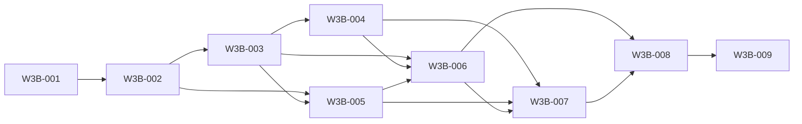

# Wave 3B — Runtime-Neutral Live Output and Structured Activity Streaming — Software Design

## Architecture
The canonical dependency diagram below defines the declared delivery topology.

## Components
### W3B-001 — Gate stream work and isolate the sole parallel ownership zone
Start ROR-25 only from the exact independently reviewed Wave 2 contracts in a worktree and file-ownership zone separate from ROR-28. ROR-28 is the only permitted concurrent implementation wave; shared public-contract/generated integration is serialized.

**Boundaries**
- No explicit component boundary was declared.

### W3B-002 — Publish versioned sequenced activity and context-continuation events
Extend packages/rorca-public-contract with the runtime-neutral stream envelope and the exact context-continuation event vocabulary while preserving Wave 2 identities and explicit observability-only authority.

**Boundaries**
- Depends on W3B-001

### W3B-003 — Persist generation-isolated streams with bounded retention
Add PostgreSQL stream/checkpoint metadata and bounded raw archive linkage using existing PTY transcript/checkpoint/archive stores where practical. Never merge bytes or sequence identity across runtime generations.

**Boundaries**
- Depends on W3B-002

### W3B-004 — Adapt managed local PTY output into the neutral stream
Bridge pty-manager, run-pty-store, transcript/checkpoint codecs, execution-engine callbacks, and cancellation status to Stream v1 without replacing current raw capture or changing engine authority.

**Boundaries**
- Depends on W3B-003

### W3B-005 — Accept future federated telemetry through a bounded ingest seam
Define and test an authenticated runtime-neutral telemetry ingestion seam for a future external runtime, without implementing the Wave 4 runtime or making MCP the federation protocol.

**Boundaries**
- Depends on W3B-002
- Depends on W3B-003

### W3B-006 — Support replay and reconnect from generation-bound checkpoints
Expose bounded SSE/read APIs through sse-hub and stream repositories so clients can reconnect using opaque checkpoints, receive deterministic replay, and detect gaps or generation changes without relying on in-memory delivery.

**Boundaries**
- Depends on W3B-003
- Depends on W3B-004
- Depends on W3B-005

### W3B-007 — Enforce redaction, backpressure, and stream security boundaries
Apply source-aware redaction and bounded flow control before stream persistence/projection while retaining integrity hashes and restricted raw references for authorized review. Streaming must not become a secret or authority side channel.

**Boundaries**
- Depends on W3B-004
- Depends on W3B-005
- Depends on W3B-006

### W3B-008 — Evolve Run View without regressing xterm compatibility
Preserve the existing Run View/xterm terminal while adding a structured activity lane and visible runtime, lease, context, reconnect, gap, and cancellation state sourced through apiFetch and existing design tokens.

**Boundaries**
- Depends on W3B-006
- Depends on W3B-007

### W3B-009 — Pass stream conformance, recovery, browser, and independent review gates
Validate managed and fake-federated stream shapes, crash/reconnect/retention recovery, existing Run View compatibility, and authority separation on a fresh local database and browser before integration. No auto-merge/deploy occurs.

**Boundaries**
- Depends on W3B-008

## Data changes
- No data changes were declared.

## API changes
- No API changes were declared.

## Security and privacy
- No additional security or privacy constraints were declared.

## Migrations
- No migrations were declared.

## Operational concerns
- No additional operational concerns were declared.
