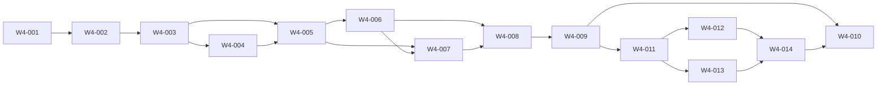

# Wave 4 — Bounded Federated Runtime Pilot — Software Design

## Architecture
The canonical dependency diagram below defines the declared delivery topology.

## Components
### W4-001 — Gate the pilot on Wave 2 and both exact Wave 3 packets
Start ROR-26 only after Wave 2 contracts and the separately integrated, independently reviewed Wave 3A RorcaManagedExecutor and Wave 3B stream packets are complete at exact compatible revisions. Wave 4 is sequential; no overlap with another implementation wave is permitted.

**Boundaries**
- No explicit component boundary was declared.

### W4-002 — Register one authenticated external runtime identity
Implement a bounded registry/credential profile for exactly one pilot external runtime. Identity is workspace-scoped, versioned, rotatable, least-privilege, and separate from operator, GitHub App, database, model-provider, and human approval credentials.

**Boundaries**
- Depends on W4-001

### W4-003 — Serve canonical HTTP lease and work-package contracts
Expose authenticated HTTP/service operations for the one runtime to discover eligible work, acquire one lease, read its exact work-package/context inputs, renew, and release. MCP is only an optional generated projection and not the federation protocol.

**Boundaries**
- Depends on W4-002

### W4-004 — Provision exact-revision bounded mutation inputs
Give the leased runtime only the exact repository/spec/work-package/context material and bounded mutation paths needed for one work package. Git remains code truth and runtime-provided revisions never override host verification.

**Boundaries**
- Depends on W4-003

### W4-005 — Ingest idempotent federated events and activity streams
Accept normalized Wave 2 execution events and Wave 3B sequenced activity/PTY telemetry from the leased runtime under bounded batch, sequence, redaction, and backpressure controls.

**Boundaries**
- Depends on W4-003
- Depends on W4-004

### W4-006 — Verify proposed results with host-observed evidence
Allow the runtime to submit a versioned result proposal and artifact references, then require host verification of lease, repository/worktree, exact changes, validation, and provider projections before canonical evidence/closeout services evaluate it.

**Boundaries**
- Depends on W4-005

### W4-007 — Require cancellation acknowledgement and governed plan changes
Deliver cancellation to the external runtime and require exact-fence acknowledgement while preserving host expiry/termination authority. Accept plan-change proposals only for human/system review under Wave 2 revision contracts.

**Boundaries**
- Depends on W4-005
- Depends on W4-006

### W4-008 — Fail closed through context, lease, network, runtime, and controller recovery
Implement bounded restart/reconciliation for host, Hermes controller/companion, external runtime, canonical-context, and network failures. Recovery follows the same checkpoint/retrieval/one-use-dispatch state machine as RorcaManagedExecutor and cannot infer completion from silence or terminal output.

**Boundaries**
- Depends on W4-006
- Depends on W4-007

### W4-009 — Run identical managed-versus-federated continuation conformance and fault injection
Execute the same Wave 2/Wave 3 normative conformance assertions against RorcaManagedExecutor and the one federated Hermes/runtime lane through declared transport/trust adapters on fresh local infrastructure, including the full context-continuation fault matrix.

**Boundaries**
- Depends on W4-008

### W4-011 — Implement the governed Doctor check/fix controller
Implement operational reconciliation as an explicit detect/classify/propose/authority/execute/verify/outcome/escalate controller. Checks and fixes remain separate and cannot rewrite canonical truth or infer destructive/provider authority.

**Boundaries**
- Depends on W4-009

### W4-012 — Suspend idle loops with an event-driven cost circuit breaker
Replace autonomous no-change polling with bounded event-driven wake and durable suspension so idle controllers cannot burn provider spend or create overlapping retry loops.

**Boundaries**
- Depends on W4-011

### W4-013 — Provision and offboard inventoried provider, runtime, and Forgejo resources
Implement one canonical workspace-scoped resource inventory and an idempotent staged saga for provider, runtime, and Forgejo provisioning, identity-preserving updates, credential lifecycle, and separately authorized offboarding.

**Boundaries**
- Depends on W4-011

### W4-014 — Certify noisy-neighbor isolation and clean-room reconstruction
Fault-inject workspace/runtime resource exhaustion and reconstruct the pilot lane from canonical declared inputs on a fresh isolated host namespace before the final pilot demonstration.

**Boundaries**
- Depends on W4-012
- Depends on W4-013

### W4-010 — Demonstrate one bounded merge-ready draft PR without release authority
After conformance and independent review, run exactly one pilot work package through the external runtime to host-verified closeout and a real repository-scoped GitHub App draft PR/Check projection at the exact head. Stop at merge-ready review evidence.

**Boundaries**
- Depends on W4-009
- Depends on W4-014

## Data changes
- No data changes were declared.

## API changes
- No API changes were declared.

## Security and privacy
- No additional security or privacy constraints were declared.

## Migrations
- No migrations were declared.

## Operational concerns
- No additional operational concerns were declared.
