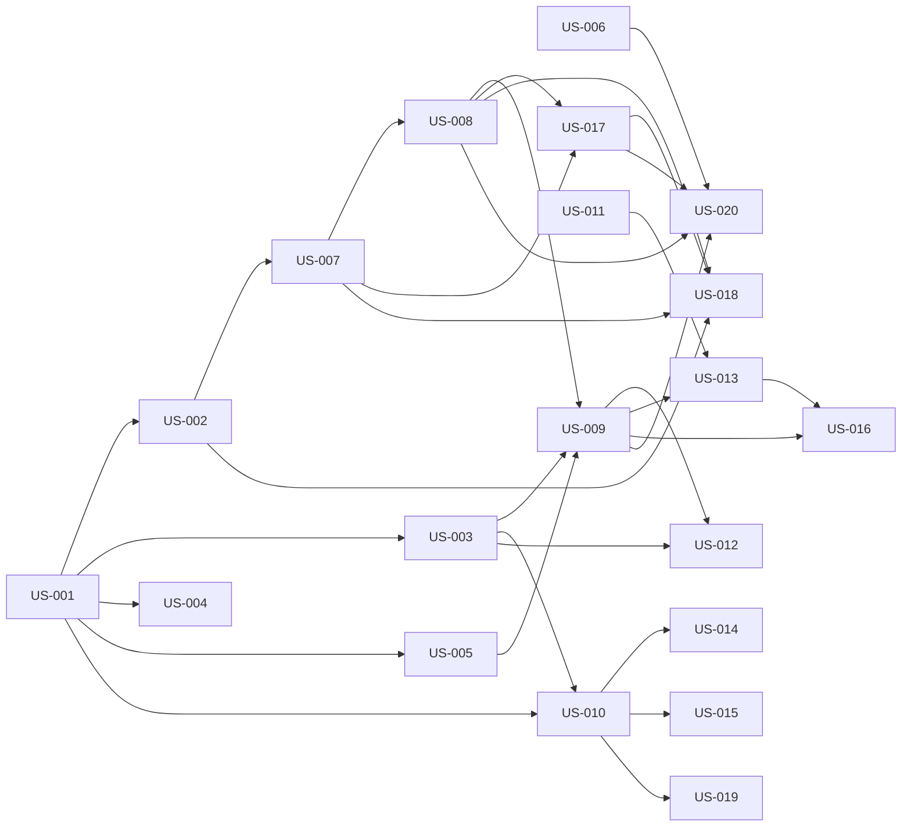

# add copy paste photo as attachment (meaning someone can screen capture with whatever tool they want and attach it to the new spec description screen here where i am typing now) and also an upload file so that users can upload PRD, SDD or whatever they want as context. — Diagrams

Generated: 2026-03-11T08:01:49.452Z

## storyDeps

### Mermaid


### ASCII
```
US-001
  └─ US-002
    └─ US-007
      └─ US-008
        └─ US-009
          └─ US-012
          └─ US-013
            └─ US-016
          └─ US-020
        └─ US-017
          └─ US-018
  └─ US-003
    └─ US-010
      └─ US-014
      └─ US-015
      └─ US-019
  └─ US-004
  └─ US-005
US-006
US-011
```
