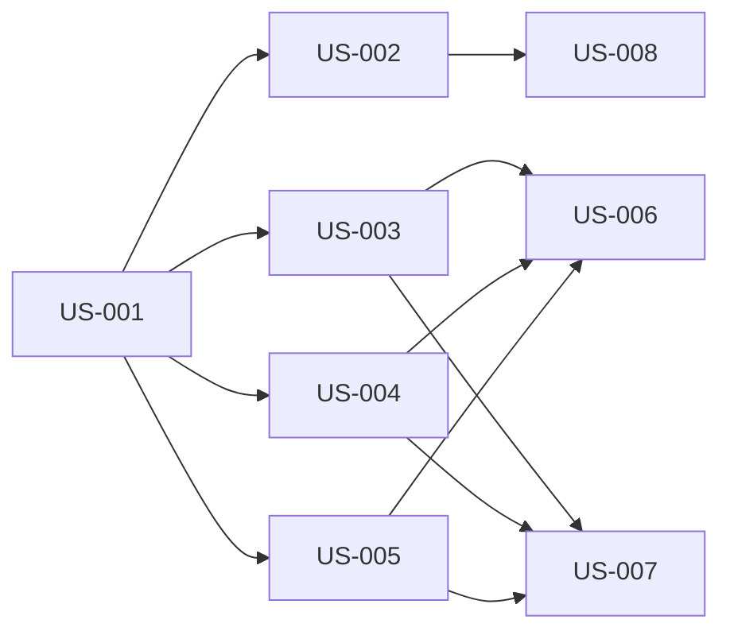

# Add a health check endpoint — Diagrams

Generated: 2026-03-10T02:51:50.929Z

## storyDeps

### Mermaid


### ASCII
```
US-001
  └─ US-002
    └─ US-008
  └─ US-003
    └─ US-006
    └─ US-007
  └─ US-004
  └─ US-005
```
