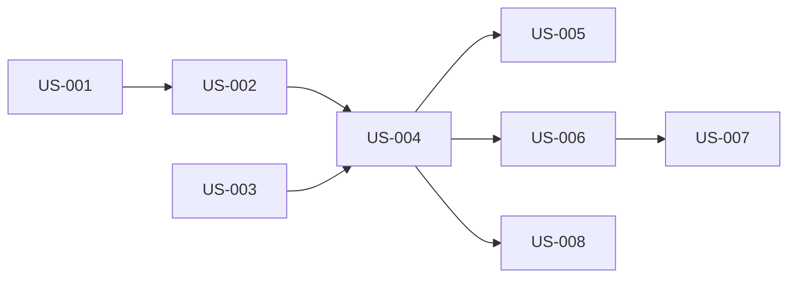

# build a spec to turn the wake page into columns similar to fizzy.do: draft, in-progress, and done from left to right cards like kanban style and with the draft to have approve deny but also you can click on the card and it expands into the current card that says run pipeline, etc — Diagrams

Generated: 2026-03-08T21:53:48.233Z

## storyDeps

### Mermaid


### ASCII
```
US-001
  └─ US-002
    └─ US-004
      └─ US-005
      └─ US-006
        └─ US-007
      └─ US-008
US-003
```
