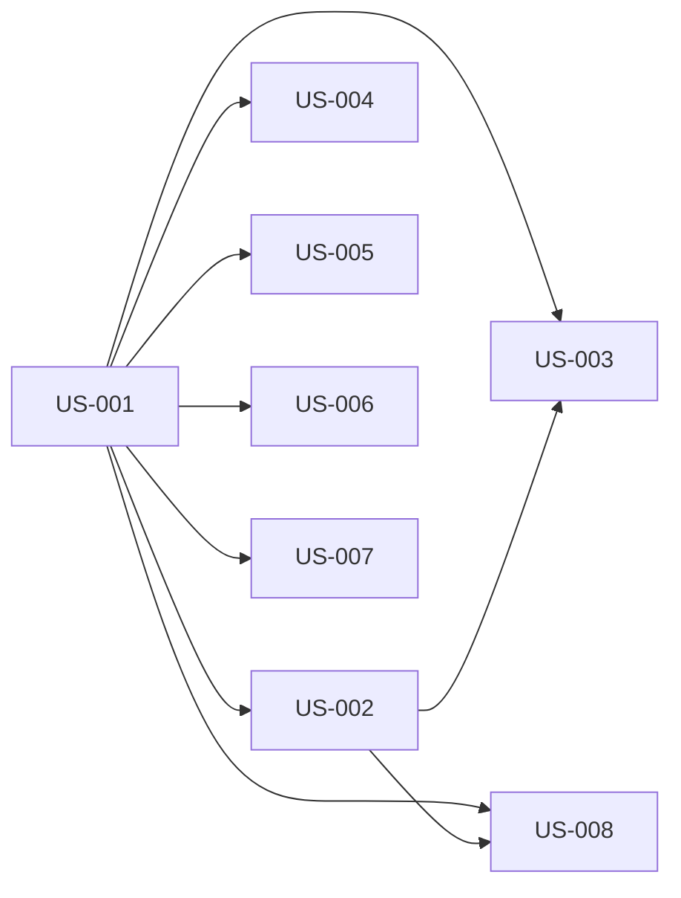

# Create a test that will an e2e audit of the UX architecture to ensure everything flows smoothly — Diagrams

Generated: 2026-03-10T05:53:14.579Z

## storyDeps

### Mermaid


### ASCII
```
US-001
  └─ US-002
    └─ US-003
    └─ US-008
  └─ US-004
  └─ US-005
  └─ US-006
  └─ US-007
```
