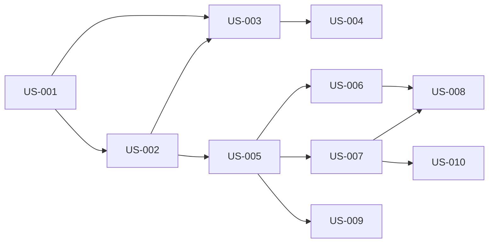

# Extract the Marketplace view from the Specs panel so that the Specs header becomes just "Board | List", and add Marketplace as a new 6th sidebar nav item with its own route (/marketplace) and dedicated MarketplacePanel.tsx. The panel has three top-level tabs — Skills, Templates, Convention Packs — and below those tabs a full-width search bar with source-selector pills (skills.sh, GitHub Repos, Custom) that filter the left side of a horizontal split view. The left panel shows discovery results from the selected source with skill name, category badge, description preview, and an "Install" button per card; the right panel shows "Your Library (N)" — the user's installed skills with category filter pills (All, Frontend, Backend, Security, DevOps, etc.), remove buttons, and an export action. Installing a skill from the left moves it to the right; removing from the right does the inverse. The search bar auto-focuses on panel mount, searches are client-side filtered when browsing installed skills and API-driven (GET /api/skills/search?q=...&source=skills.sh) when browsing external sources. This layout solves the current problem where the skills.sh search and GitHub install UI are buried at the bottom of a 38-card scrollable list and invisible without scrolling.
 — Diagrams

Generated: 2026-03-11T07:30:15.787Z

## storyDeps

### Mermaid


### ASCII
```
US-001
  └─ US-002
    └─ US-003
      └─ US-004
    └─ US-005
      └─ US-006
        └─ US-008
      └─ US-007
        └─ US-010
      └─ US-009
```
