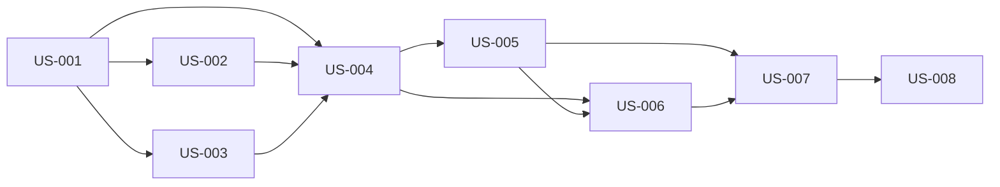

# Fix Quick Run spec generation to use the full direction + memory context cascade.

POST /api/pipeline/quick-run in backend/src/routes/pipeline.ts generates a 1-story spec with a bare LLM call (step 7, quickRunPrompt) that has no awareness of the workspace's direction stack, MEMORY.md, or installed skills. Fix this so the spec is generated with the same context that regular POST /api/specs/generate uses.

Changes needed in backend/src/routes/pipeline.ts:

After resolving the workspace, call synthesize(workspaceId, domain) from backend/src/lib/direction-stack.ts to get the merged L1–L3 direction context string.

Read MEMORY.md from the workspace root (path.join(workspace.path, 'MEMORY.md')) — if it exists, include the first 2000 chars prefixed with === MEMORY.md ===.

Read installed skills from GET /api/skills?workspaceId= internally (or query the DB directly) — include skill names + descriptions as a brief list prefixed with === INSTALLED SKILLS ===.

Prepend all three context blocks to the quickRunPrompt before the === INSTRUCTIONS === section. If a block is empty/missing, skip it silently.

Increase the acceptance criteria limit from 5 to 8 to match the richer context now available.

The LLM call itself (chatComplete) stays unchanged — only the prompt content changes. The spec JSON schema and pipeline trigger logic are untouched. — Diagrams

Generated: 2026-03-11T19:15:42.541Z

## storyDeps

### Mermaid


### ASCII
```
US-001
  └─ US-002
    └─ US-004
      └─ US-005
        └─ US-006
          └─ US-007
            └─ US-008
  └─ US-003
```
