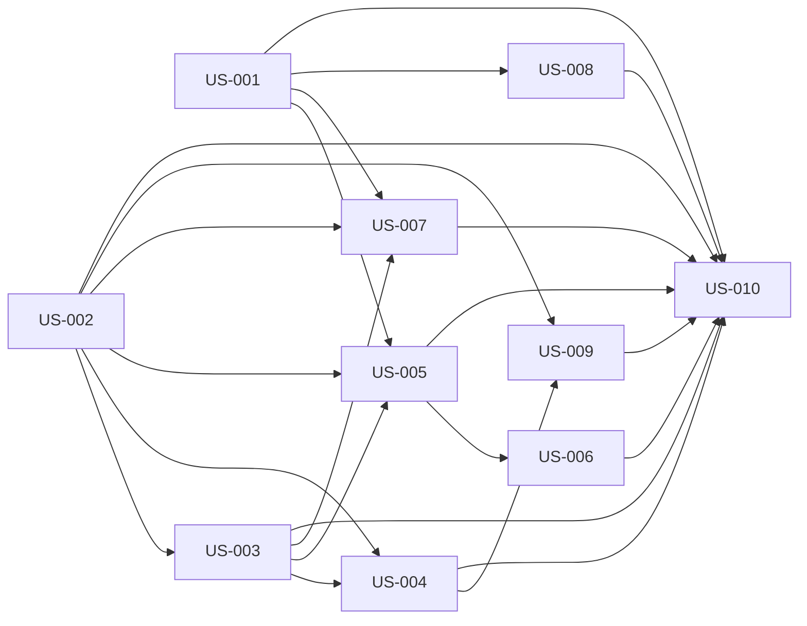

# rorca-agent-context-parity — Diagrams

Generated: 2026-03-16T03:50:44.066Z

## storyDeps

### Mermaid


### ASCII
```
US-001
  └─ US-005
    └─ US-006
      └─ US-010
  └─ US-007
  └─ US-008
US-002
  └─ US-003
    └─ US-004
      └─ US-009
```
