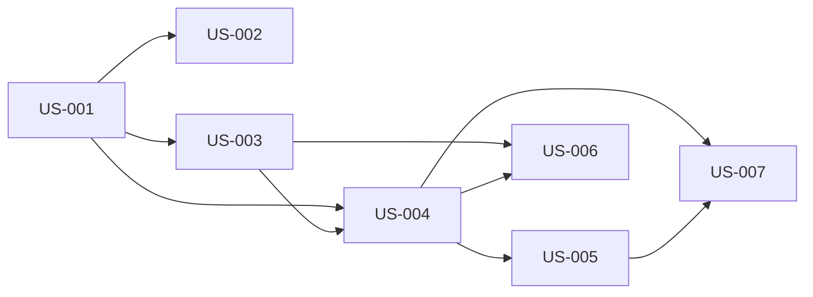

# rorca-auto-merge — Diagrams

Generated: 2026-03-13T19:35:41.126Z

## storyDeps

### Mermaid


### ASCII
```
US-001
  └─ US-002
  └─ US-003
    └─ US-004
      └─ US-005
        └─ US-007
      └─ US-006
```
