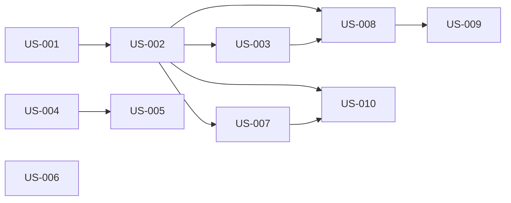

# rorca-context-autohydrate — Diagrams

Generated: 2026-03-13T07:32:54.338Z

## storyDeps

### Mermaid


### ASCII
```
US-001
  └─ US-002
    └─ US-003
      └─ US-008
        └─ US-009
    └─ US-007
      └─ US-010
US-004
  └─ US-005
US-006
```
