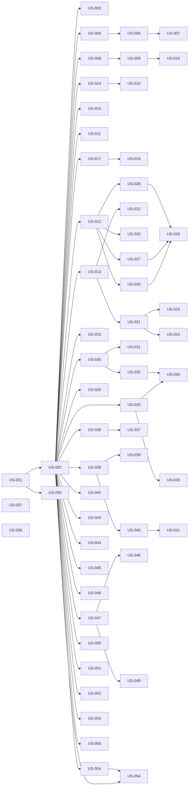

# rorca-docs-v1 — Diagrams

Generated: 2026-03-16T04:19:02.688Z

## storyDeps

### Mermaid


### ASCII
```
US-001
  └─ US-002
    └─ US-003
    └─ US-004
      └─ US-054
    └─ US-005
      └─ US-006
        └─ US-007
    └─ US-008
      └─ US-009
        └─ US-019
    └─ US-010
    └─ US-011
    └─ US-012
      └─ US-025
      └─ US-026
        └─ US-029
      └─ US-027
      └─ US-028
    └─ US-013
      └─ US-021
        └─ US-023
        └─ US-024
      └─ US-022
    └─ US-014
      └─ US-016
    └─ US-015
    └─ US-017
      └─ US-018
    └─ US-020
    └─ US-030
      └─ US-031
      └─ US-032
        └─ US-034
    └─ US-033
      └─ US-035
    └─ US-036
      └─ US-037
    └─ US-038
      └─ US-039
      └─ US-040
        └─ US-041
    └─ US-042
    └─ US-043
    └─ US-044
    └─ US-045
    └─ US-046
    └─ US-047
      └─ US-048
      └─ US-049
    └─ US-050
    └─ US-051
    └─ US-052
    └─ US-053
    └─ US-056
  └─ US-055
US-057
US-058
```
