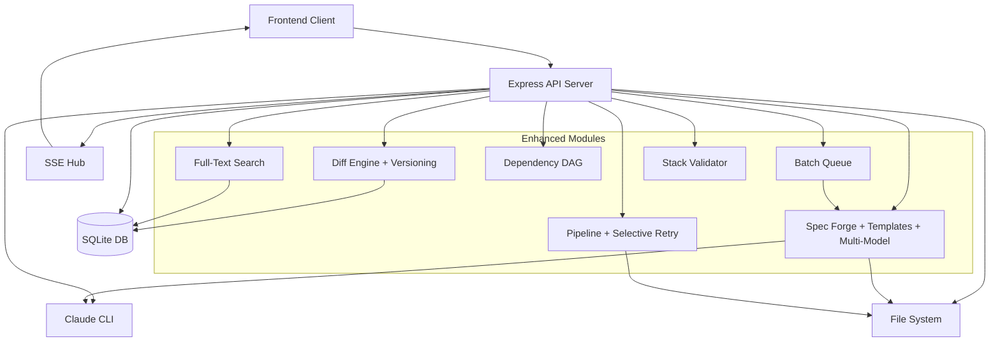
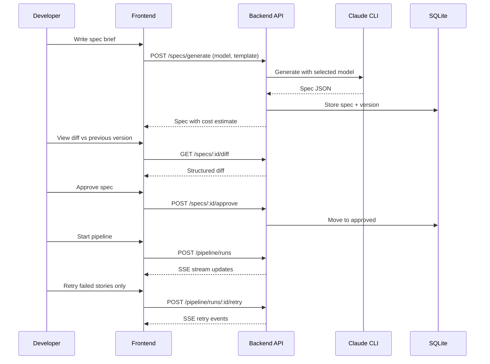
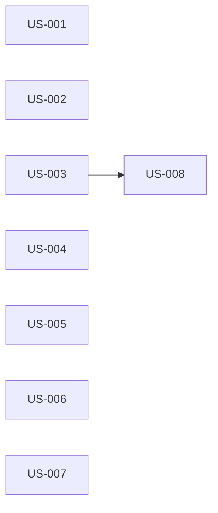

# rorca-feature-enhancements — Diagrams

Generated: 2026-02-22T09:31:45.570Z

## architecture

### Mermaid


### ASCII
```
┌─────────────┐     ┌──────────────────┐     ┌──────────┐
│   Frontend   │────▶│  Express API     │────▶│ SQLite   │
│   Client     │◀────│  Server          │     │ Database │
└─────────────┘ SSE  ├──────────────────┤     └──────────┘
                     │ Enhanced Modules: │     ┌──────────┐
                     │ • Spec Forge     │────▶│ Claude   │
                     │ • Diff Engine    │     │ CLI      │
                     │ • Search         │     └──────────┘
                     │ • Pipeline Retry │     ┌──────────┐
                     │ • DAG Visualizer │────▶│ File     │
                     │ • Batch Queue    │     │ System   │
                     │ • Stack Validator│     └──────────┘
                     └──────────────────┘
```

## userFlow

### Mermaid


### ASCII
```
Developer ──▶ Write Brief ──▶ Generate Spec (choose model)
                                    │
                              ┌─────▼─────┐
                              │ Compare    │
                              │ Versions   │──▶ View Diff
                              └─────┬─────┘
                                    │
                              ┌─────▼─────┐
                              │ Approve /  │
                              │ Reject     │
                              └─────┬─────┘
                                    │
                              ┌─────▼─────┐
                              │ Pipeline   │
                              │ Execute    │
                              └─────┬─────┘
                                    │
                              ┌─────▼─────┐
                              │ Retry      │
                              │ Failed     │
                              └─────┘
```

## storyDeps

### Mermaid


### ASCII
```
US-001
US-002
US-003
  └─ US-008
US-004
US-005
US-006
US-007
```
