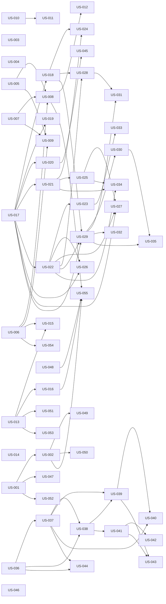

# rorca-go-to-market-v1 — Diagrams

Generated: 2026-03-15T22:39:41.845Z

## storyDeps

### Mermaid


### ASCII
```
US-001
  └─ US-002
    └─ US-049
    └─ US-050
    └─ US-055
  └─ US-047
  └─ US-052
US-003
US-004
US-005
  └─ US-008
    └─ US-012
  └─ US-009
US-006
  └─ US-015
  └─ US-054
US-007
US-010
  └─ US-011
US-013
  └─ US-016
  └─ US-051
  └─ US-053
US-014
US-017
  └─ US-018
    └─ US-024
    └─ US-028
      └─ US-031
    └─ US-029
      └─ US-030
        └─ US-035
      └─ US-032
  └─ US-019
  └─ US-020
    └─ US-045
  └─ US-021
    └─ US-025
      └─ US-027
      └─ US-034
  └─ US-022
    └─ US-023
      └─ US-033
    └─ US-026
US-036
  └─ US-037
    └─ US-038
      └─ US-039
        └─ US-040
        └─ US-043
      └─ US-041
        └─ US-042
    └─ US-044
US-046
US-048
```
