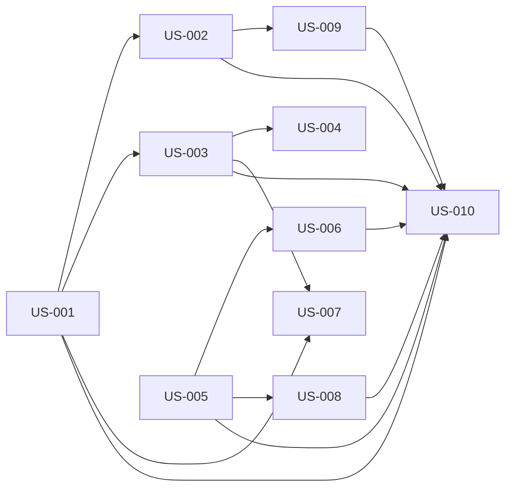

# rorca-knowledge-graph-ui — Diagrams

Generated: 2026-03-19T08:40:47.735Z

## storyDeps

### Mermaid


### ASCII
```
US-001
  └─ US-002
    └─ US-009
      └─ US-010
  └─ US-003
    └─ US-004
    └─ US-007
US-005
  └─ US-006
  └─ US-008
```
