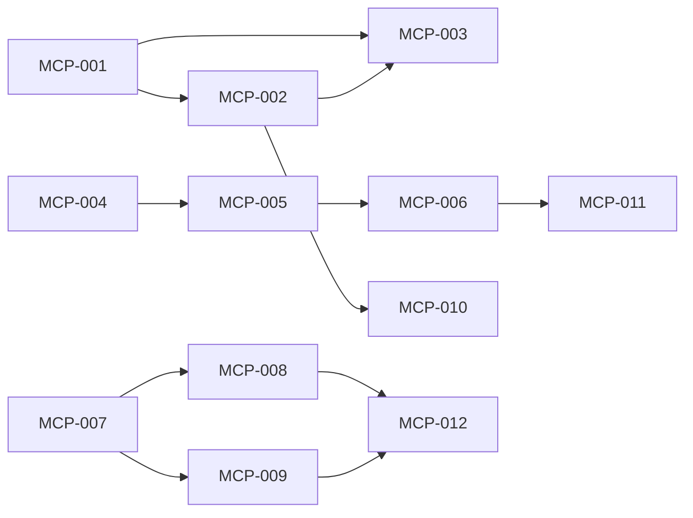

# rorca-mcp-enhancements — Diagrams

Generated: 2026-03-29T06:30:36.931Z

## storyDeps

### Mermaid


### ASCII
```
MCP-001
  └─ MCP-002
    └─ MCP-003
    └─ MCP-010
MCP-004
  └─ MCP-005
    └─ MCP-006
      └─ MCP-011
MCP-007
  └─ MCP-008
    └─ MCP-012
  └─ MCP-009
```
