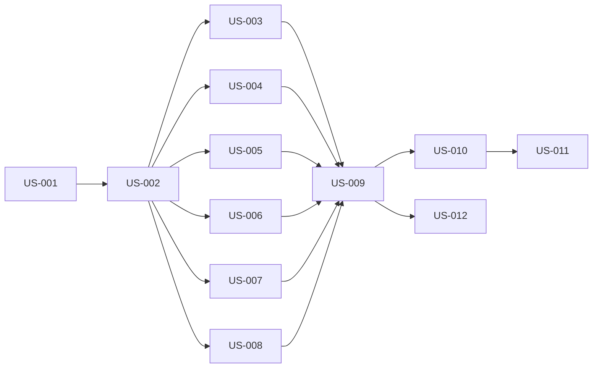

# rorca-mcp-recall-tool — Diagrams

Generated: 2026-03-15T22:08:39.676Z

## storyDeps

### Mermaid


### ASCII
```
US-001
  └─ US-002
    └─ US-003
      └─ US-009
        └─ US-010
          └─ US-011
        └─ US-012
    └─ US-004
    └─ US-005
    └─ US-006
    └─ US-007
    └─ US-008
```
