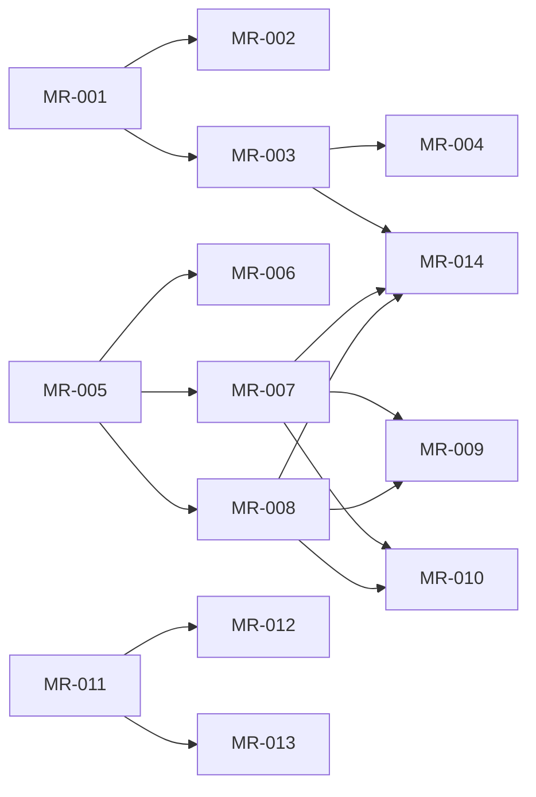

# rorca-mcp-robustness — Diagrams

Generated: 2026-04-01T00:19:12.785Z

## storyDeps

### Mermaid


### ASCII
```
MR-001
  └─ MR-002
  └─ MR-003
    └─ MR-004
    └─ MR-014
MR-005
  └─ MR-006
  └─ MR-007
    └─ MR-009
    └─ MR-010
  └─ MR-008
MR-011
  └─ MR-012
  └─ MR-013
```
