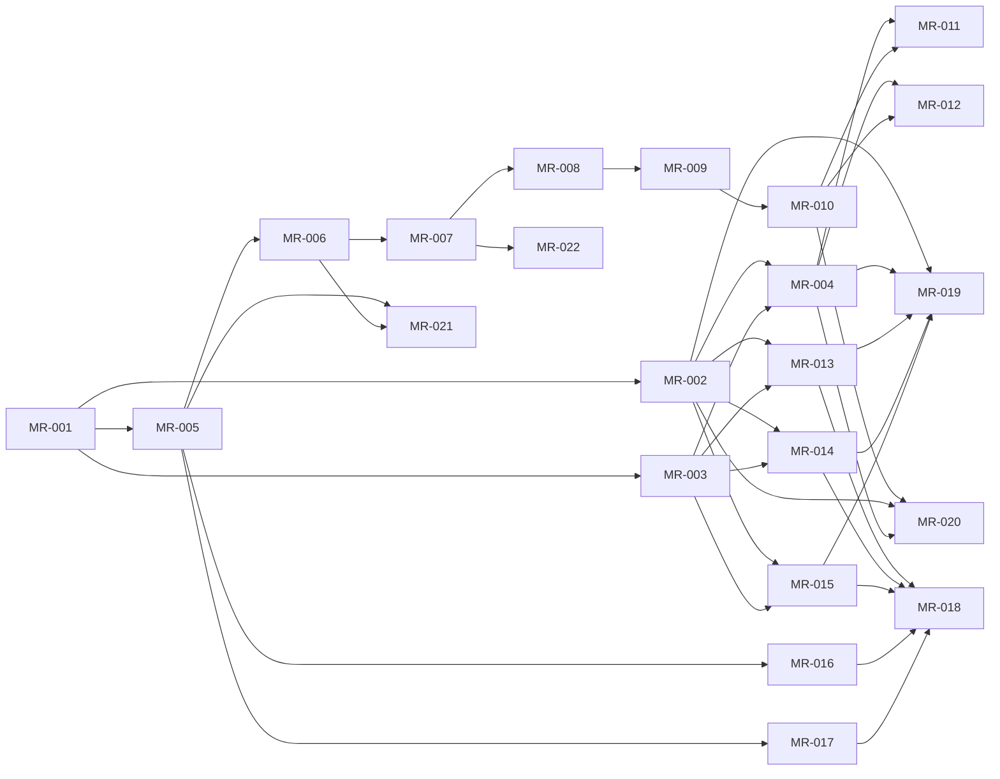

# rorca-model-capability-registry-p1 — Diagrams

Generated: 2026-04-25T23:42:10.182Z

## storyDeps

### Mermaid


### ASCII
```
MR-001
  └─ MR-002
    └─ MR-004
      └─ MR-011
      └─ MR-012
      └─ MR-019
      └─ MR-020
    └─ MR-013
      └─ MR-018
    └─ MR-014
    └─ MR-015
  └─ MR-003
  └─ MR-005
    └─ MR-006
      └─ MR-007
        └─ MR-008
          └─ MR-009
            └─ MR-010
        └─ MR-022
      └─ MR-021
    └─ MR-016
    └─ MR-017
```
