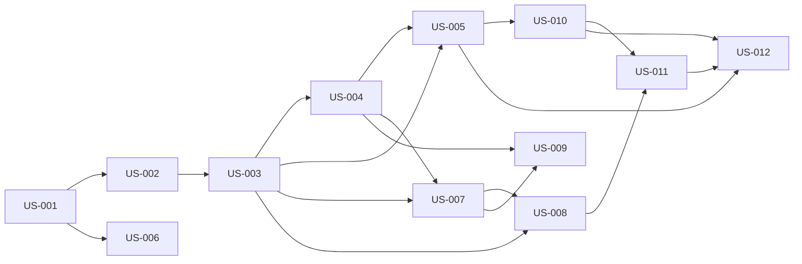

# rorca-pipeline-queueing-and-worktrees — Diagrams

Generated: 2026-03-17T19:26:23.932Z

## storyDeps

### Mermaid


### ASCII
```
US-001
  └─ US-002
    └─ US-003
      └─ US-004
        └─ US-005
          └─ US-010
            └─ US-011
              └─ US-012
        └─ US-007
          └─ US-008
          └─ US-009
  └─ US-006
```
