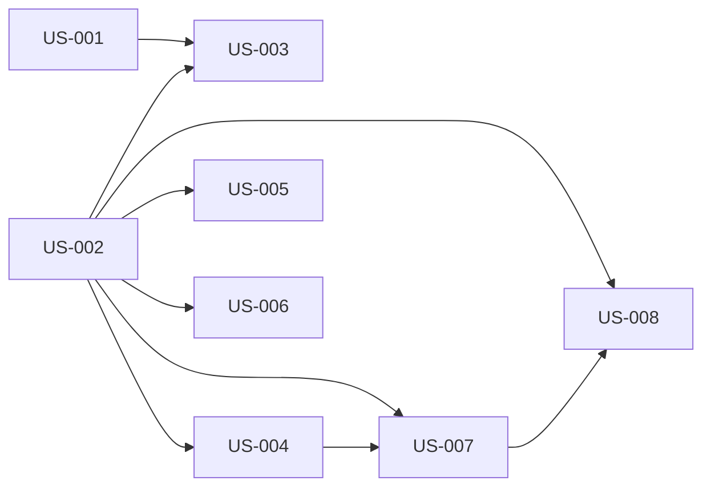

# rorca-post-run-qa — Diagrams

Generated: 2026-03-12T06:26:42.557Z

## storyDeps

### Mermaid


### ASCII
```
US-001
  └─ US-003
US-002
  └─ US-004
    └─ US-007
      └─ US-008
  └─ US-005
  └─ US-006
```
