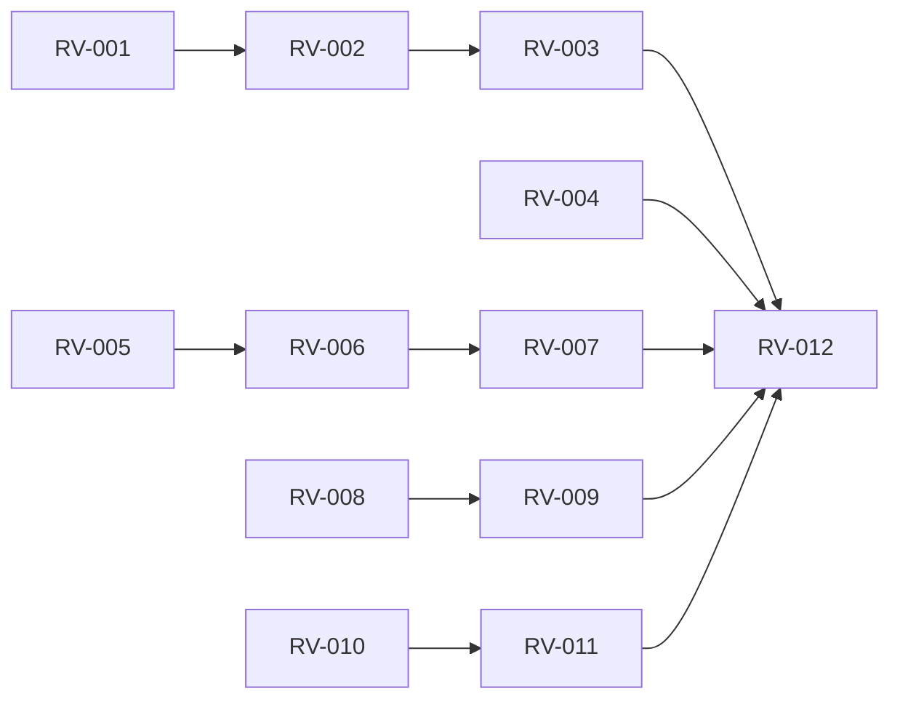

# rorca-run-view-bug-fixes — Diagrams

Generated: 2026-04-03T19:24:41.339Z

## storyDeps

### Mermaid


### ASCII
```
RV-001
  └─ RV-002
    └─ RV-003
      └─ RV-012
RV-004
RV-005
  └─ RV-006
    └─ RV-007
RV-008
  └─ RV-009
RV-010
  └─ RV-011
```
