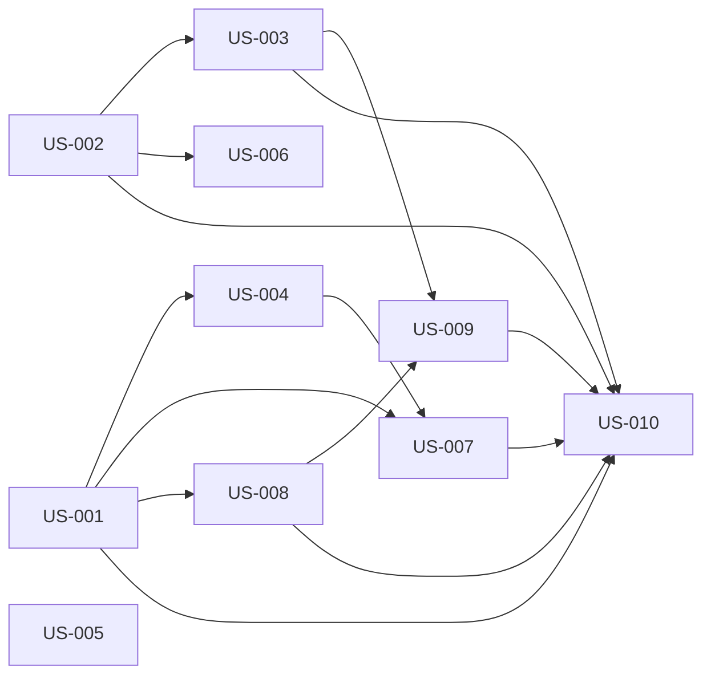

# rorca-run-view-streaming-fix — Diagrams

Generated: 2026-03-15T09:34:59.951Z

## storyDeps

### Mermaid


### ASCII
```
US-001
  └─ US-004
    └─ US-007
      └─ US-010
  └─ US-008
    └─ US-009
US-002
  └─ US-003
  └─ US-006
US-005
```
