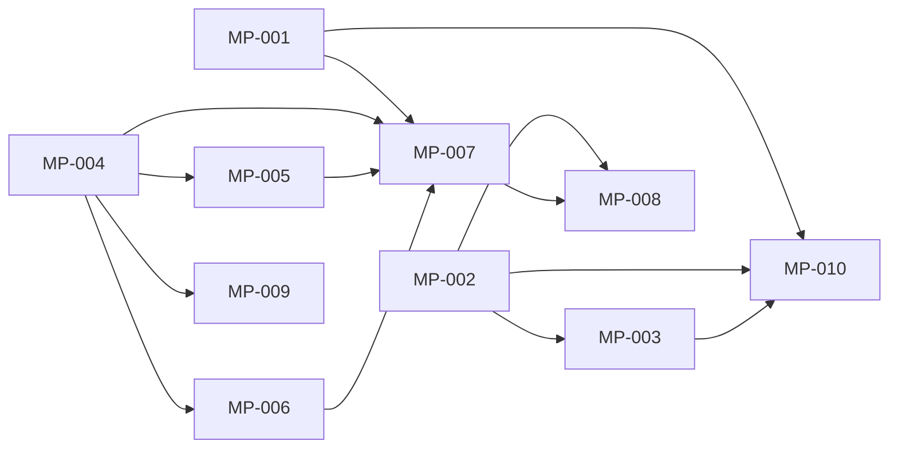

# rorca-spec-model-picker — Diagrams

Generated: 2026-04-03T18:32:13.051Z

## storyDeps

### Mermaid


### ASCII
```
MP-001
  └─ MP-007
    └─ MP-008
  └─ MP-010
MP-002
  └─ MP-003
MP-004
  └─ MP-005
  └─ MP-006
  └─ MP-009
```
