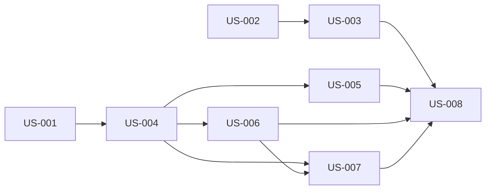

# rorca-terminal-sse-overhaul — Diagrams

Generated: 2026-03-17T20:29:20.485Z

## storyDeps

### Mermaid


### ASCII
```
US-001
  └─ US-004
    └─ US-005
      └─ US-008
    └─ US-006
      └─ US-007
US-002
  └─ US-003
```
