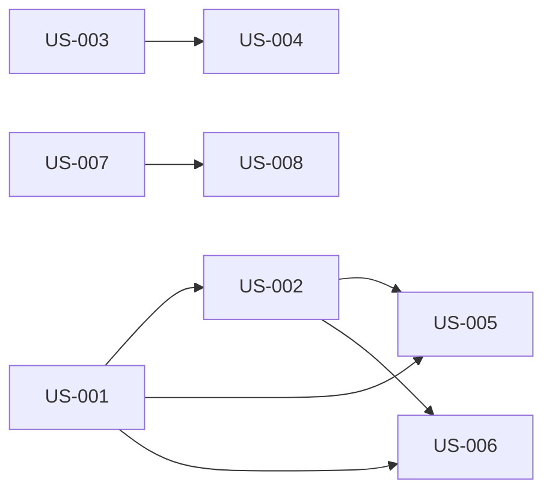

# i want you to make this spec brief feature state of the art and make the uiux amazing so that even a blind man can see it — Diagrams

Generated: 2026-02-28T05:46:59.749Z

## storyDeps

### Mermaid


### ASCII
```
US-001
  └─ US-002
    └─ US-005
    └─ US-006
US-003
  └─ US-004
US-007
  └─ US-008
```
